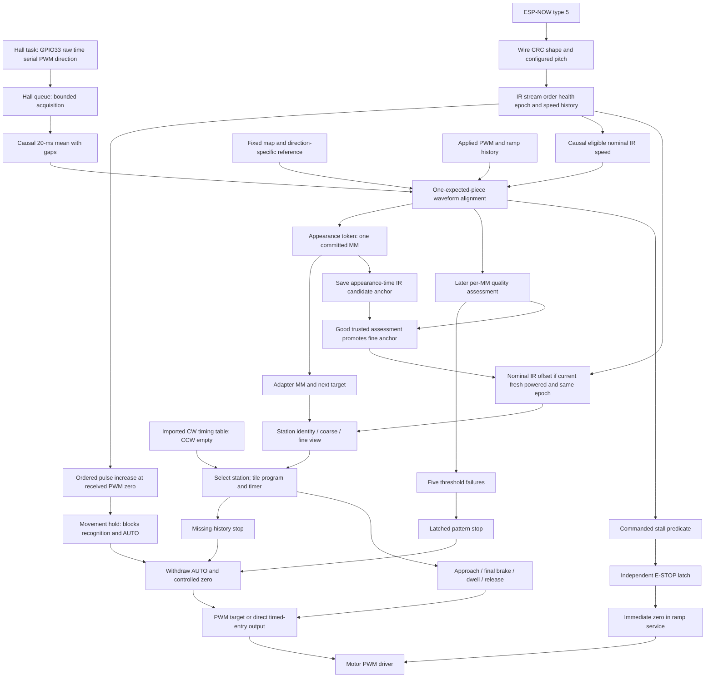
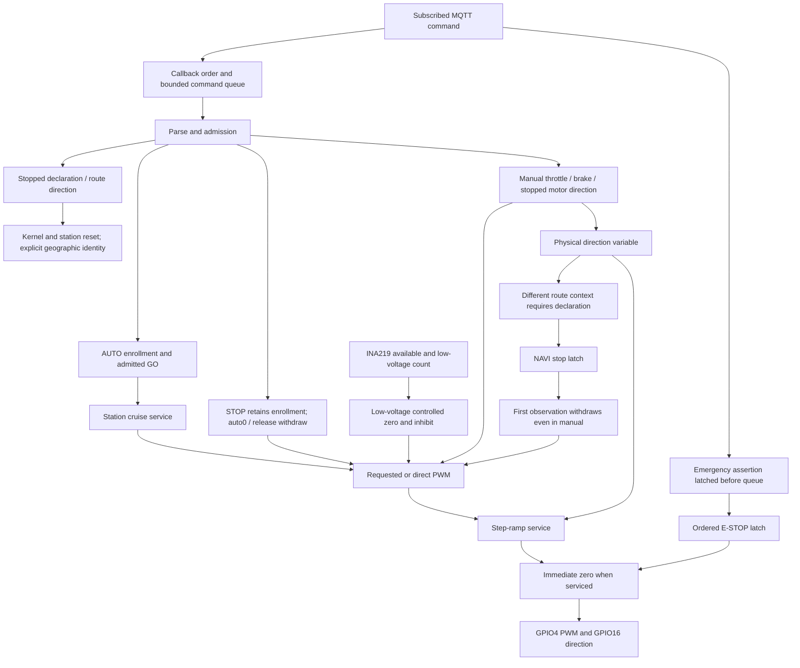

# Behavioral dependency map

Candidate `d18fe67e52deda91720be4384cd77c8f53c62cf0`. Arrows below follow actual call/data dependencies; they do not imply that every input change produces every output. Findings and B-IDs refer to the [report](REPORT.md) and [authority ledger](BEHAVIORAL_AUTHORITY_LEDGER.md).

## Sensor-to-controller paths

Exact edges: Hall acquisition [NAVI_RVM.ino:498–542](https://github.com/ninobur/esp-loco-control/blob/d18fe67e52deda91720be4384cd77c8f53c62cf0/firmware/test-programs/NAVI_RVM/NAVI_RVM.ino#L498-L542), block formation [NaviIntegratedCore.h:101–110](https://github.com/ninobur/esp-loco-control/blob/d18fe67e52deda91720be4384cd77c8f53c62cf0/firmware/test-programs/NAVI_RVM/NaviIntegratedCore.h#L101-L110), IR decoding [NAVI_RVM.ino:544–603](https://github.com/ninobur/esp-loco-control/blob/d18fe67e52deda91720be4384cd77c8f53c62cf0/firmware/test-programs/NAVI_RVM/NAVI_RVM.ino#L544-L603), IR context/hold [NaviIntegratedCore.h:70–98](https://github.com/ninobur/esp-loco-control/blob/d18fe67e52deda91720be4384cd77c8f53c62cf0/firmware/test-programs/NAVI_RVM/NaviIntegratedCore.h#L70-L98), recognition [NaviIntegratedCore.h:186–209](https://github.com/ninobur/esp-loco-control/blob/d18fe67e52deda91720be4384cd77c8f53c62cf0/firmware/test-programs/NAVI_RVM/NaviIntegratedCore.h#L186-L209) and [RvmRecognizer.h:42–165](https://github.com/ninobur/esp-loco-control/blob/d18fe67e52deda91720be4384cd77c8f53c62cf0/firmware/test-programs/NAVI_RVM/RvmRecognizer.h#L42-L165), geographic/fine installation [NaviIntegratedCore.h:193–204](https://github.com/ninobur/esp-loco-control/blob/d18fe67e52deda91720be4384cd77c8f53c62cf0/firmware/test-programs/NAVI_RVM/NaviIntegratedCore.h#L193-L204), station program [NAVI_RVM.ino:936–996](https://github.com/ninobur/esp-loco-control/blob/d18fe67e52deda91720be4384cd77c8f53c62cf0/firmware/test-programs/NAVI_RVM/NAVI_RVM.ino#L936-L996), stop execution [NAVI_RVM.ino:450–485](https://github.com/ninobur/esp-loco-control/blob/d18fe67e52deda91720be4384cd77c8f53c62cf0/firmware/test-programs/NAVI_RVM/NAVI_RVM.ino#L450-L485).

There is **no edge** from per-pulse diagnostic speed, DART credibility evaluator, `TargetSpec.polarity`, warning text or published RVM telemetry back into the kernel. There **is** an edge from allocation success for diagnostic resources to whether setup permits any operation (B59). There **is** an indirect external edge from operator-visible status to later operator/UI commands; the running server version is not known.

## Operator/dispatcher, motor and safety paths

`requestPwm` clamps and sets target, `serviceRamp` applies immediate E-STOP zero before ordinary ramps; station entry/timed PWM has a second direct `writePwm` path guarded by the shell's current AUTO/safety state. Startup drives motor low before creating tasks. Exact actuator sites: [NAVI_RVM.ino:401–449](https://github.com/ninobur/esp-loco-control/blob/d18fe67e52deda91720be4384cd77c8f53c62cf0/firmware/test-programs/NAVI_RVM/NAVI_RVM.ino#L401-L449) [NAVI_RVM.ino:976–994](https://github.com/ninobur/esp-loco-control/blob/d18fe67e52deda91720be4384cd77c8f53c62cf0/firmware/test-programs/NAVI_RVM/NAVI_RVM.ino#L976-L994) [NAVI_RVM.ino:1377–1460](https://github.com/ninobur/esp-loco-control/blob/d18fe67e52deda91720be4384cd77c8f53c62cf0/firmware/test-programs/NAVI_RVM/NAVI_RVM.ino#L1377-L1460). There is no PI/PID speed governor, current-triggered E-STOP, local IR GPIO34 reader, Blynk controller or TrainPacket receiver in this active sketch.

## Main-loop execution and interruption consequences

`loop` services the motor first, updates the running clock, notes observation loss, drains type-5 IR, applies PWM-zero/navigation holds, drains operator commands, processes a bounded Hall slice, applies new navigation stops, publishes decisions, executes station/cruise control, emits diagnostics, services the motor again, then updates battery/status/pulse reporting. [NAVI_RVM.ino:1474–1527](https://github.com/ninobur/esp-loco-control/blob/d18fe67e52deda91720be4384cd77c8f53c62cf0/firmware/test-programs/NAVI_RVM/NAVI_RVM.ino#L1474-L1527)

This ordering makes several distinctions material:

1. Callback E-STOP assertion does not wait for the ordinary command queue, but physical zero occurs when motor service runs; this is not an interrupt directly writing the driver.
2. IR hold may be applied before a queued declaration or manual command. Declaration is the explicit clearing path; a first navigation withdrawal can overwrite manual target, while later manual commands can be accepted if independent E-STOP/voltage protection does not prohibit them.
3. Hall acquisition timestamps remain original, but backlog delays the decision and station instruction. Commit time is not the original sample time. The running clock removes disabled-AUTO time, whereas the recognizer still observes physically powered manual movement.
4. RVM token emission updates MM before telemetry enqueue. Dropped reports do not cancel a tile. A final-quality record updates trust/fine position but does not execute a second tile.
5. A station timer never increments MM. Timer expiry can nevertheless command zero (F05); preserving geographic identity alone does not guarantee working dwell/release.

## Exact ingress contract

All ordinary command topics are subscribed in [NAVI_RVM.ino:1205–1220](https://github.com/ninobur/esp-loco-control/blob/d18fe67e52deda91720be4384cd77c8f53c62cf0/firmware/test-programs/NAVI_RVM/NAVI_RVM.ino#L1205-L1220), parsed/admitted in [NAVI_RVM.ino:769–868](https://github.com/ninobur/esp-loco-control/blob/d18fe67e52deda91720be4384cd77c8f53c62cf0/firmware/test-programs/NAVI_RVM/NAVI_RVM.ino#L769-L868) and [Ops.h:55–194](https://github.com/ninobur/esp-loco-control/blob/d18fe67e52deda91720be4384cd77c8f53c62cf0/firmware/test-programs/NAVI_RVM/Ops.h#L55-L194). The concrete identifier is `ngr/loco/9950011` for this Otto profile. Prefix abbreviations below are literal structure, not proposed renamed topics.

| Input | Route and behavior | Geographic and recovery effect |
|---|---|---|
| `ngr/loco/<id>/cmd/estop`, `ngr/dispatcher/cmd/estop` | Assertion ordered and latched in callback; release cannot clear newer assertion. | Keeps MM; RVM stall reasserts until declaration. Ordinary remote E-STOP has no automatic relocation/reset. |
| `ngr/loco/<id>/cmd/auto` | 1 enrolls; 0 disables running/enrollment and requests zero. | No declaration or reference reset. GO is a separate action. |
| `ngr/dispatcher/cmd/go/<id>` | Admitted only when enrolled, declared usable, forward and no safety latch. | Enables execution of current instructions. |
| `ngr/dispatcher/cmd/stop/<id>` | Requests controlled zero, disables running, retains enrollment. | STOP/GO memory retained. |
| `ngr/loco/<id>/cmd/dispatcher_release` | Clears running/enrollment and requests zero. | No geographic reset; returns command ownership. |
| `ngr/loco/<id>/cmd/throttle`, `/cmd/brake` | Manual throttle admission and downward-ramp brake setting. | Powered manual observations can still update RVM. |
| `ngr/loco/<id>/cmd/direction` | Physical motor direction 0=reverse, 2=forward; only fully stopped and not enrolled. | Changed context may require new declaration; no live reverse recognizer. |
| `ngr/loco/<id>/cmd/session_direction`, `/cmd/start_mm`, `/cmd/start_interval` | Valid direction/MM/adjacency plus stopped admission. | Explicit initializer resets RVM/navigation holds and station execution. |
| `ngr/loco/<id>/cmd/ir_pair`, `/cmd/ir_coupled` | Pair display/NVS and coupled reporting only. | Neither filters incoming source authority nor independently enables navigation. |
| ESP-NOW type 5 | CRC-valid configured cumulative IR instrument snapshot, then integrity/order evaluation. | Supports speed/fine offset and PWM-zero hold; not a separate tile counter. |
| ESP-NOW types 6/7 | Separate diagnostic queues. | No runtime motor/geographic mutation. Failure to allocate their queues halts setup. |
| Reference dispatcher TrainPacket | No matching receive parser in this candidate. | No emergency/start/stop action through that radio path. Verify actual deployed transport before relying on it. |

The handler also recognizes some local GO/STOP forms that are not subscribed; symbol presence does not make them live ingress. Bare dispatcher GO/STOP, dispatcher CE enrollment, TrainPacket and CTO2 are not silently inferred from other firmware. The inspected repository server's per-locomotive fanout is an example of a compatible MQTT route, not proof of installed service configuration. [ngr_app_v1_10_11.py:2340–2395](https://github.com/ninobur/esp-loco-control/blob/d18fe67e52deda91720be4384cd77c8f53c62cf0/server/ngr_app_v1_10_11.py#L2340-L2395) [LL_MQ_CO_GC_DI_1_2.ino:325–330](https://github.com/ninobur/esp-loco-control/blob/d18fe67e52deda91720be4384cd77c8f53c62cf0/Reference/LL_MQ_CO_GC_DI_1_2.ino#L325-L330) [LL_MQ_CO_GC_DI_1_2.ino:377–384](https://github.com/ninobur/esp-loco-control/blob/d18fe67e52deda91720be4384cd77c8f53c62cf0/Reference/LL_MQ_CO_GC_DI_1_2.ino#L377-L384)

## Terminal stop/hold and clearing matrix

| Trigger | Motor / AUTO consequence | Stops future RVM observation? | Clearing and authority |
|---|---|---|---|
| Ordinary operator STOP or auto0 | Controlled ramp to zero; STOP keeps enrollment, auto0 clears it. | No, except geographic phase naturally pauses at PWM0. | Admitted GO/auto enrollment; no declaration. Required operating control. |
| Station final region | Final ramp, actual-zero five-second dwell, then release/cruise. | No independent recognizer reset. | Physical executor; no declaration. Required. Timed Penultimate mismatch is F05. |
| Pattern-loss latch | Controlled zero, withdraw AUTO, sticky warning. | Yes; adapter `stopRequested_` blocks Hall processing. | Explicit stopped declaration. Required outcome; current predicate contradictory F02. |
| Recognized physical stall | E-STOP plus withdrawal; release alone reasserts. | Yes. | Inspect, declare and clear emergency as appropriate. Required; recorded failure F07. |
| NoTimingHistory | Controlled zero, withdrawal and declaration required. | Yes. | Declare; underlying missing history remains. Legacy veto F03. |
| TimingContextChanged | Controlled zero/withdrawal. | Yes. | New position/direction declaration. Preserved no-running-reversal intent. |
| PWM-zero pulse hold | First report withdraws and requests zero; AUTO/GO denied thereafter. | Yes, through hold. | Inspection and declaration for credible displacement. Invalid evidence trigger F04. |
| External E-STOP | Immediate zero when ramp service executes; running cleared. | Does not itself reset geographic state. | Ordered release; resume only through admission; geographic declaration only if independently required. |
| Low voltage with INA ready | Controlled zero and throttle/AUTO inhibit. | No geographic reset. | Voltage recovery ≥14 V clears voltage flag, no automatic movement. |
| Missing INA | Warning; battery control disabled. | No. | Hardware/setup policy unresolved, F14. |
| Critical or diagnostic startup allocation failure | PWM0 and infinite halt. | No navigation starts. | Restart/resource correction. Required-resource safe failure retained; diagnostic dependency F11. |
| Wi-Fi/MQTT disconnect | No automatic motor stop; unavailable remote commands. | Local recognizer continues. | Reconnect; ESP-NOW initialization needs initial Wi-Fi association. |
| Hall gap, no appearance, no finite path | No token for that update; existing instruction may persist. | Can repeatedly suppress advancement without latch. | Later evidence; no general indefensible-location response implemented, F01. |

## Reference and observation dependency firewall

The physical map is compile-time data. No IR error updates it. The waveform model is compile-time data; no lap, sensor or telemetry message updates it. Only explicit declaration chooses a starting MM and reference direction. Only a new non-final RVM appearance token changes the subsequent committed MM in normal operation. Fine IR, timer and station state change instructions and interpreted fractional position but cannot increment the map index.

This boundary is necessary but not sufficient: `fineAnchor_`, `selectedClock_`, `intervalIntegrity_`, `zeroMovement_`, station `Released`, and startup resource success all retain real influence outside the kernel. Those are included in the authority ledger instead of being dismissed as adapters or diagnostics.
