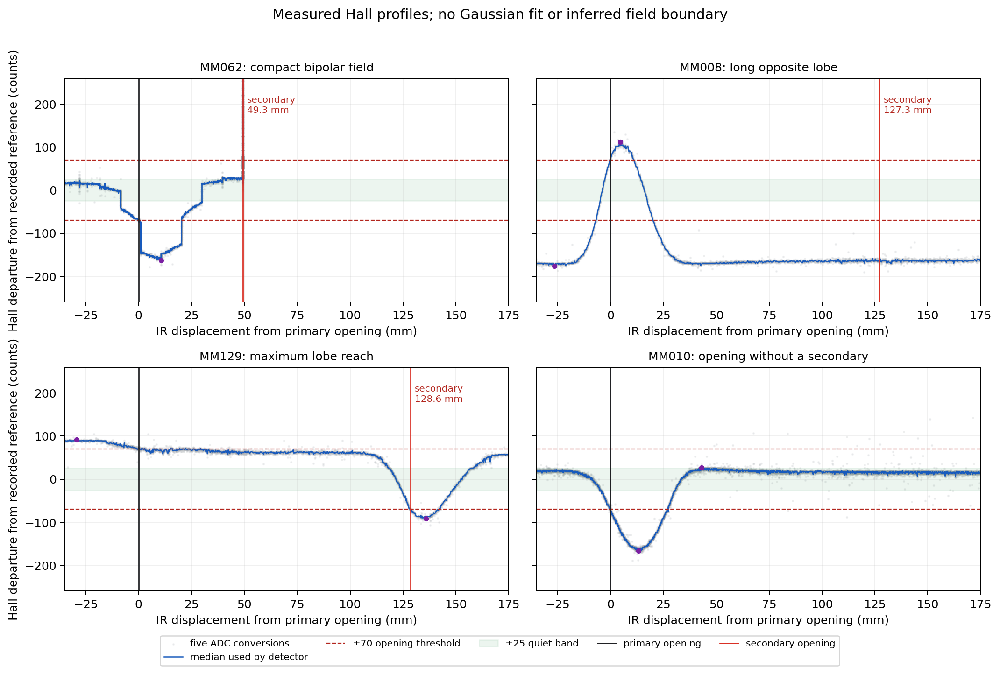
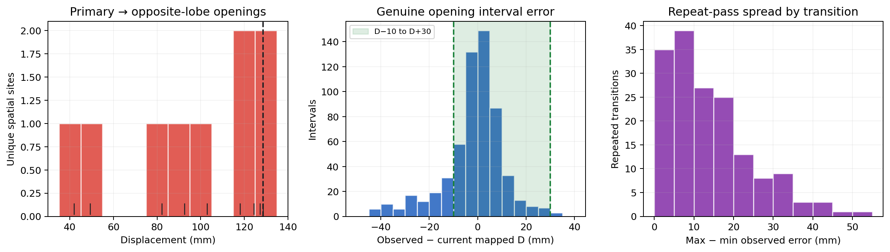
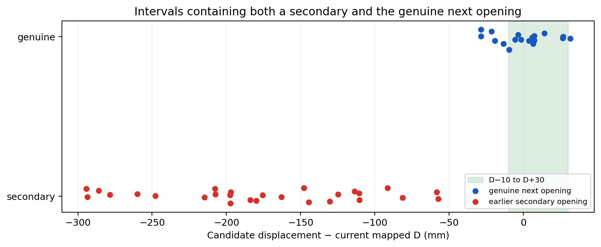

# September 29 Hall-field question: continuous-data analysis

## Finding

The September 29 MQTT log does **not** contain a continuous Hall trace suitable for reconstructing magnetic-field profiles. It records event values such as `raw_open` and occasional status snapshots such as `median5`, but not every ADC conversion. The nearest usable run is the synchronized September 28 capture `otto_navi_sync_20260928_101705.nsr`.

That run supports a practical separation **within the observed data**: inferred continuous opposite-polarity lobes opened 41.9–128.6 mm after their associated primary openings, while the shortest reliable adjacent genuine-opening interval was 257.4 mm. The resulting observed gap is 128.8 mm. In all 18 eligible intervals containing both an earlier secondary candidate and the genuine next opening, the genuine opening was the candidate closest to mapped distance D.

The run does **not** establish a universal geographic boundary. It is one locomotive/session, secondary observations are CW-only, the IR distance is nominal odometry rather than surveyed position, and assigning two openings to one physical magnet remains an inference from trace continuity. It also contradicts replacing ±15% with D−10 mm to D+30 mm: that proposed window rejects 104 of 591 reliable genuine intervals (17.6%).

## Data used

| Item | Result |
|---|---:|
| Continuous capture start | 2026-09-28 10:17:05 PDT |
| Duration | 3,377.327 s (56 min 17 s) |
| Hall batches | 3,377,328 at approximately 1 kHz |
| Individual ADC conversions | 16,886,640 (five per batch) |
| Accepted synchronized IR snapshots | 33,264 |
| Recorded Hall events matched to raw capture | 951/951 |
| Events matching the ≥70-count, two-sample, same-sign opening rule | 951/951 |
| Maximum event-to-raw timing mismatch | 1.117 ms |
| Capture datagram sequence gaps | 0 |

The Hall ring-drop count was already one in the first observed record and remained one; therefore one batch unit was lost before the observed stream, with no additional loss during the capture. The IR ring-drop count was zero. The capture SHA-256 is `3d9f0032d53fc647b1eb36fbdc579b9d6f7e06482bcd39db4505185b9b119cd7`.

IR position for each Hall sample was linearly interpolated between synchronized IR records. A local interval was retained only when its two bracketing IR records had the same source/calibration, monotonic pulse and sequence counters, unchanged reliability counters, and a bracket no longer than 300 ms. Genuine interval analysis additionally required `distance_assessable=1`, `MM_REFERENCED_EPOCH`, and a matching prior map marker.

## Measured field profiles

The gray points are all five ADC conversions and the blue line is the exact median used by the detector. Distances are measured from the recorded primary opening. The ±70 lines are relative to that primary event's recorded reference; a later secondary event can have a different adaptive reference. Purple dots are observed extrema, not fitted peaks. No Gaussian or other field model was fitted.

Representative traces show several actual shapes:

| Map marker | Primary opening | Observed primary extremum | First two-sample return to ±25 | Opposite opening | Observed opposite extremum | Subsequent two-sample return to ±25 |
|---|---:|---:|---:|---:|---:|---:|
| MM062 | −70 counts at 0 mm | −163 at +10.7 mm | +30.0 mm | +91 counts at +49.3 mm | +368 at +49.3 mm during repeated same-position observations | Not observed within plotted travel |
| MM008 | +73 counts at 0 mm | +112 at +4.7 mm | +14.4 mm | −165 counts at +127.3 mm | −170 at +132.5 mm | Not observed within plotted travel |
| MM129 | +73 counts at 0 mm | +73 at 0 mm | +118.2 mm | −71 counts at +128.6 mm | −92 at +135.8 mm | +148.6 mm |
| MM010 | −71 counts at 0 mm | −166 at +13.2 mm | +30.7 mm | None | — | — |

These profiles are asymmetric and sometimes stepped or broad. MM062 has a compact negative trough followed by an abrupt opposite opening. MM008 remains far from the primary reference over a long span; its later recorded opening is therefore an event produced by the detector's evolving reference and gating, not a direct measurement of a magnetic boundary. MM129 has a long positive shoulder before the opposite trough. MM010 is a conventional single trough with no recorded secondary. A threshold crossing, a detector opening, and a physical field boundary are different quantities.

## Secondary opposite-polarity lobes

There were 84 measured `NON_LANDMARK_HALL` openings; 81 had reliable IR and a preceding primary. “Secondary opening” is measured. “Continuous opposite lobe from the same magnet” is an offline classification, defined here as the first opposite-polarity feature after a primary, with exactly one pole crossing outside a ±25-count deadband and no continuous quiet run of 15 mm or more. Repeated openings within 5 mm after the same primary were collapsed to one spatial site.

This rule classified 15 measured openings at nine unique inferred lobe sites. Their primary-to-secondary distances were:

`41.9, 49.3, 82.2, 92.5, 103.0, 118.1, 124.5, 127.3, 128.6 mm`

| Statistic | Distance |
|---|---:|
| Minimum | 41.9 mm |
| Median | 103.0 mm |
| 95th percentile | 128.1 mm |
| Maximum observed inferred lobe reach | **128.6 mm** |
| Minimum reliable adjacent genuine-opening interval | **257.4 mm** |
| Observed gap | **128.8 mm** |

The remaining secondary events include same-polarity reopenings and more complex or spatially separated opposite features. They cannot be assigned confidently to one physical magnet from these signals alone.

## Genuine opening position and direction

The run yielded 591 reliable adjacent genuine-opening intervals, comparing observed IR displacement with the current map.

| Direction | n | Minimum error | 5th percentile | Median | 95th percentile | Maximum |
|---|---:|---:|---:|---:|---:|---:|
| All | 591 | −44.8 mm | −26.7 mm | +0.1 mm | +15.1 mm | +35.0 mm |
| CW | 557 | −42.6 mm | −26.0 mm | +0.1 mm | +15.2 mm | +35.0 mm |
| CCW | 34 | −44.8 mm | −41.4 mm | −0.1 mm | +10.0 mm | +14.2 mm |

There were 806 genuine primary openings: 754 CW and 52 CCW. All 84 secondary openings were CW, so this run cannot test whether the secondary-lobe geometry reverses or changes in CCW travel.

For 164 direction-and-transition groups observed at least twice, the median max-minus-min spread was 11.2 mm; the 95th percentile was 34.4 mm and the maximum was 50.5 mm. The median within-group standard deviation was 4.5 mm. These are interval-position repeatability figures based on IR odometry, not absolute geographic survey errors.

Three map intervals changed after this capture. Against the capture-era map, the 591 errors were −42.8 mm minimum, −23.9 mm at the 5th percentile, +0.3 mm median, +15.1 mm at the 95th percentile, and +35.0 mm maximum. The window assessment below uses the current map as requested.

## Candidate choice and distance window

Eighteen eligible adjacent intervals contained 27 earlier secondary candidates plus the eventual genuine next opening. The genuine opening was closest to D in **18/18** intervals. None of the earlier secondary candidates entered either the proposed D−10/D+30 window or the existing ±15% window. This is direct support for selecting the Hall candidate closest to expected mapped distance, subject to the run's limited direction and locomotive coverage.

The proposed absolute window does not preserve genuine openings:

| Window | Genuine intervals accepted | Rejected below | Rejected above | Total rejected |
|---|---:|---:|---:|---:|
| D−10 mm to D+30 mm | 487/591 (82.4%) | 101 | 3 | 104 (17.6%) |
| D ±15% | 591/591 (100%) | — | — | 0 |

The evidence therefore supports closest-to-D ranking, but contradicts adopting D−10/D+30 as the sole acceptance window. The lower edge is the main failure: 101 genuine observations arrived more than 10 mm early. The upper edge also missed three genuine observations by as much as 35.0 mm.

## Practical answer and limitations

The September 28 continuous run shows a large empirical separation between the inferred same-magnet opposite lobes and the next genuine map opening. That separation is strong enough to explain why closest-to-D selection worked perfectly in the 18 mixed-candidate intervals observed here. It is not enough to claim a reliable universal cutoff without at least one comparable CCW run, additional locomotives/sensor heights and speeds, and independently surveyed position.

Additional limitations are:

- IR pitch was 9.652 mm per pulse and telemetry marked distance bounds `UNVALIDATED`; interpolation improves time alignment but does not create sub-pulse metrology.
- The firmware records an adaptive Hall reference. A later opening's reference may differ from the primary reference shown in a profile.
- Stationary or slow movement can produce repeated openings at nearly the same position; those were collapsed only for the inferred lobe-site distribution.
- The physical magnet center, pole geometry, sensor height, and field boundary were not instrumented. The analysis measures detector observations and IR displacement.
- The sample contains no CCW secondary opening, so directional symmetry of secondary fields is unknown.
- September 29 itself provides event-level Hall evidence only; the field-shape conclusions come from the authorized nearby-day fallback.

## Reproducibility

The complete machine-readable result is in [`continuous_hall_analysis.json`](continuous_hall_analysis.json). The research-only decoder, filtering rules, statistics, and plot generation are in [`analyze_continuous_hall.py`](analyze_continuous_hall.py). Source copies are under [`sources/`](sources/). No firmware, governing specification, or magnet map was changed.
