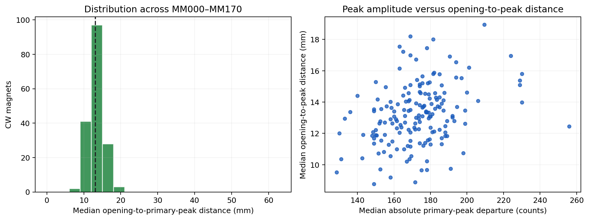
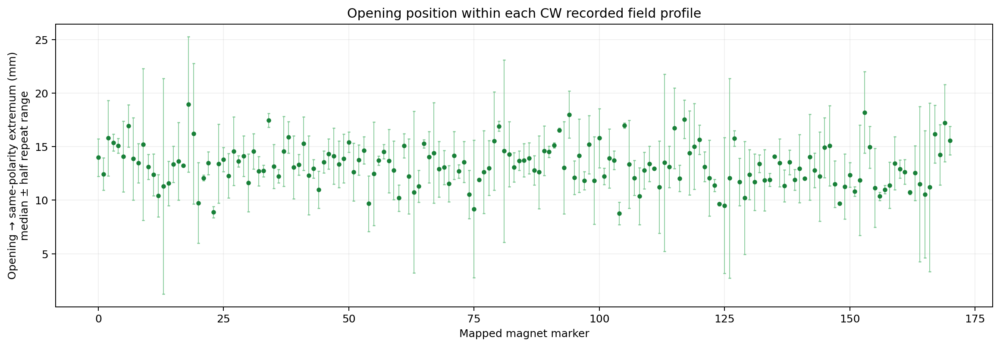
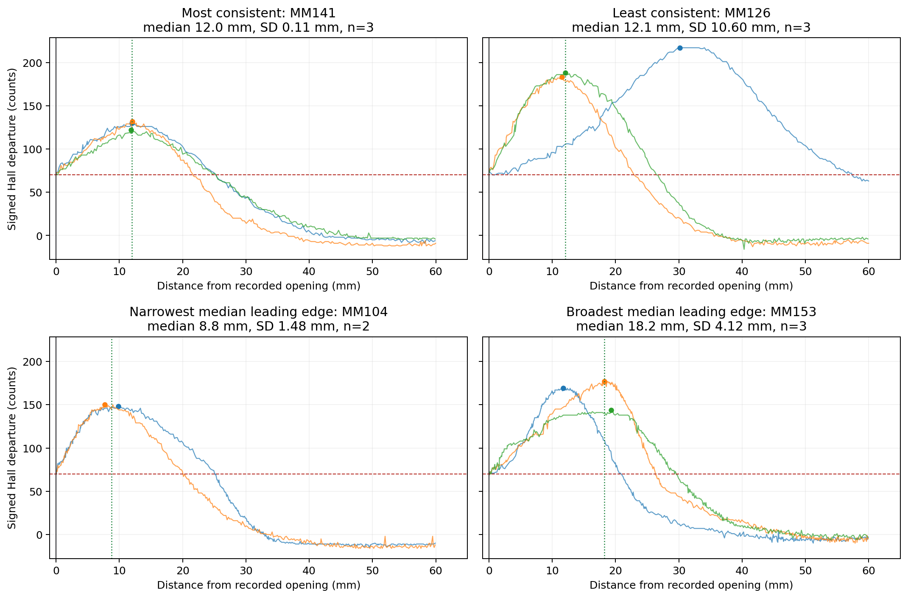
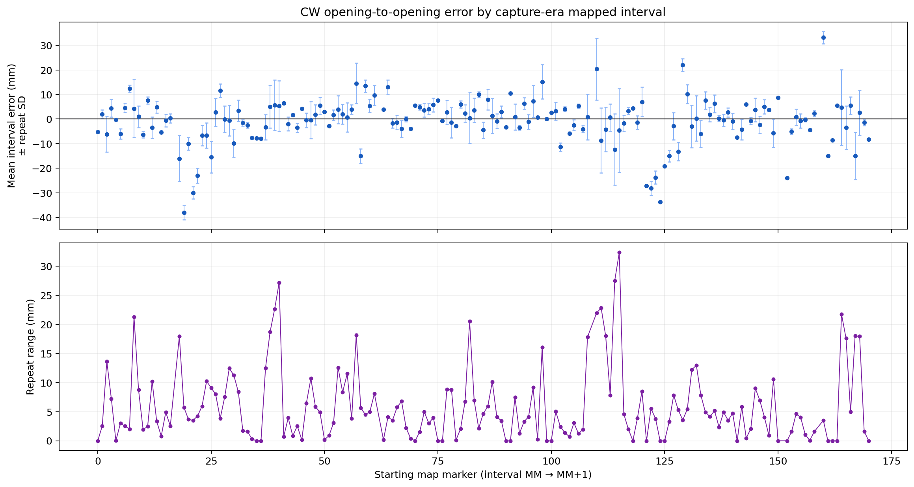
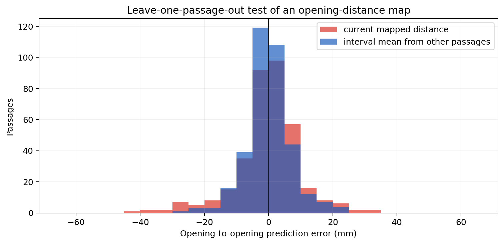

# Hall opening-to-primary-peak investigation

## Answer

The September 28 continuous capture shows that the opening-to-primary-peak distance is usually repeatable to a few millimeters, but it is not sufficiently distinctive by itself to identify individual magnets. Across all 171 CW magnets, the median opening-to-peak distance was 13.13 mm and the between-magnet standard deviation of those medians was only 1.93 mm. For the 117 magnets with at least three usable CW peaks, the median repeat standard deviation was 2.34 mm. Thus normal repeat variation is comparable to, or larger than, much of the difference between magnets.

A calibrated map of **observed opening-to-opening intervals** is more promising. In a leave-one-passage-out test, it reduced prediction RMSE from 9.98 mm for the capture-era physical-spacing map to 6.94 mm. However, differences in opening-to-peak distance did not explain those interval offsets: the peak-offset difference model explained only 0.08% of interval-error variance. The data therefore support direct empirical calibration of opening intervals more strongly than deriving them from peak locations.

The hypothesis that maximum absolute ADC departure marks physical magnet center remains unverified. No physical magnet center was surveyed in this recording, and the expected geographic relationship between peak offsets and interval errors was absent.

## Measurement method

The analysis used the September 28 synchronized capture with all five ADC conversions and the detector median at approximately 1 kHz, plus synchronized IR odometry.

For each mapped magnet and direction:

1. The opening is the recorded second consecutive median sample at least 70 counts from its event reference.
2. Only high-confidence `ADVANCED` events were assigned to a physical mapped magnet. `ADVANCED_WITH_DISCREPANCY` observations were excluded because they frequently had the wrong polarity for that magnet and could not preserve physical identity.
3. The trace was polarity-normalized at the opening.
4. The primary field ended at the start of the first spatial run at least 3 mm long below the same-polarity 70-count threshold.
5. The maximum signed departure before that exit was the primary peak. This prevents an opposite-polarity secondary lobe from becoming the selected peak.
6. If no sustained exit occurred within 80 mm or the bounded trace window, the peak was marked censored rather than assigned to a later feature.

There were 585 high-confidence profiles: 559 CW and 26 CCW. Of these, 529 had an isolated primary peak and 56 were censored. Every MM000–MM170 magnet had at least one usable CW estimate.

The complete per-magnet table is available as [a readable Markdown table](magnet_opening_variation.md) and [CSV](magnet_opening_variation.csv). The table includes passage count, usable peak count, median, mean, sample standard deviation, range, median peak amplitude, and censored count for each observed direction.

## Distribution and repeatability

CW per-magnet median opening-to-peak distances:

| Statistic | Distance |
|---|---:|
| Minimum | 8.77 mm |
| 5th percentile | 10.21 mm |
| Median | 13.13 mm |
| Mean | 13.23 mm |
| 95th percentile | 16.82 mm |
| Maximum | 18.94 mm |
| Between-magnet SD | 1.93 mm |

Repeatability for the 117 CW magnets with at least three usable peaks:

| Repeat statistic | Result |
|---|---:|
| Median within-magnet SD | 2.34 mm |
| 95th percentile within-magnet SD | 6.61 mm |
| SD ≤2 mm | 47/117 (40.2%) |
| SD ≤5 mm | 104/117 (88.9%) |
| SD >10 mm | 1/117 (0.9%) |

Another 53 CW magnets had two usable peaks and one magnet, MM017, had only one usable peak because two of its three primary profiles were censored. Sub-millimeter standard deviations should not be interpreted as sub-millimeter physical accuracy; the apparent precision comes from interpolation between IR pulse observations.

The per-magnet medians cluster tightly around 13 mm. Some repeat ranges are large even where the median is ordinary, showing that a single unusual passage can dominate a magnet-specific estimate.

## Representative waveforms

Each curve is a separate high-confidence CW passage, aligned at its recorded opening. The red line is the 70-count opening level, colored dots are the selected primary maxima, and the green line is the per-magnet median opening-to-peak distance.

| Example | Usable passes | Median | SD | Range | Interpretation |
|---|---:|---:|---:|---:|---|
| MM141 | 3 | 12.01 mm | 0.11 mm | 0.21 mm | Most consistent three-pass profile |
| MM126 | 3 | 12.06 mm | 10.60 mm | 18.63 mm | Least consistent; peaks at 11.50, 12.06, and 30.13 mm |
| MM104 | 2 | 8.77 mm | 1.48 mm | 2.10 mm | Narrowest fully observed median example |
| MM153 | 3 | 18.20 mm | 4.12 mm | 7.63 mm | Broadest fully observed repeated example |

The MM126 traces demonstrate why a median alone is insufficient. Two passages have nearly identical peaks around 12 mm, while one has a much broader primary field and peaks around 30 mm. All three satisfy the same opening rule and have the same polarity.

## Peak amplitude

Peak amplitude was not a strong predictor of opening-to-peak distance:

| Comparison | n | Pearson r | Spearman r |
|---|---:|---:|---:|
| All usable CW passages | 503 | −0.044 | +0.307 |
| CW magnet medians | 171 | +0.335 | +0.329 |
| Within-magnet centered passages | 503 | −0.122 | +0.305 |

The magnet-level relationship is weak to moderate and noisy. The near-zero passage-level Pearson correlation shows that absolute peak amplitude cannot supply a reliable linear correction for leading-edge width. The positive rank correlations suggest a weak monotonic tendency, but not one accurate enough to predict an individual opening-to-peak offset.

## CW and CCW

Only 26 magnets had a high-confidence CCW observation, and each had exactly one CCW passage. Relative to the corresponding CW median, CCW opening-to-peak distance differed by:

| Statistic | CCW minus CW |
|---|---:|
| Mean | −0.21 mm |
| Median | −0.82 mm |
| SD | 2.87 mm |
| Minimum | −4.96 mm |
| Maximum | +5.91 mm |

The average difference does not indicate a large overall direction bias, but the paired CW/CCW correlation was only 0.12. With one CCW observation per magnet, the run cannot establish direction-specific repeatability or confirm that the same physical peak was sampled symmetrically. The individual pairs are in [cw_ccw_peak_comparison.csv](cw_ccw_peak_comparison.csv).

## Geographic implications

If the measured peak were the physical magnet center, an interval from magnet A to B should have:

`opening interval error ≈ opening-to-peak(A) − opening-to-peak(B)`

For 145 high-confidence repeated intervals, regression of mean interval error on that predicted difference produced:

| Model | Slope | Correlation | R² |
|---|---:|---:|---:|
| Difference in median opening-to-peak offsets | −0.105 | −0.029 | 0.00084 |
| Difference in mean ≥70 field widths | −0.155 | −0.068 | 0.00463 |

The peak-center model would call for a slope near +1 and substantial explained variance. The observed relationship is effectively zero and has the wrong sign. Differences in measured leading-edge width therefore do not explain the systematic MM-to-MM discrepancies in this run. This does not prove the peak is displaced from the physical center; it shows that the recording provides no geographic validation of the peak-center assumption.

The interval discrepancies themselves contain a repeatable component. Among 145 repeated high-confidence interval groups containing 356 passages, 80.2% of error variance lay between intervals and the pooled within-interval SD was 5.78 mm.

Examples of the distinction are:

| CW interval | Capture-era map | Observed mean | Mean error | Repeat SD | Interpretation |
|---|---:|---:|---:|---:|---|
| MM084→085 | 300 mm | 310.00 mm | +10.00 mm | 1.08 mm | Stable interval-specific offset |
| MM068→069 | 300 mm | 300.13 mm | +0.13 mm | 1.12 mm | Stable agreement with map |
| MM115→116 | 300 mm | 295.36 mm | −4.64 mm | 17.02 mm | Least repeatable three-pass interval |
| MM114→115 | 300 mm | 287.65 mm | −12.35 mm | 14.44 mm | Large offset and variation |

Five CW intervals lacked a high-confidence adjacent pair: starts MM017, MM062, MM109, MM151, and MM159. Nine CCW intervals had one observation each and cannot support repeatability statistics. The full interval table is [interval_opening_distances.csv](interval_opening_distances.csv).

Using the mean opening interval from the other passages as a leave-one-passage-out prediction gave:

| Predictor | RMSE | MAE |
|---|---:|---:|
| Capture-era physical-spacing map | 9.98 mm | 6.92 mm |
| Calibrated opening-interval mean | 6.94 mm | 5.11 mm |

The calibrated result reduced RMSE by 30.5% and MAE by 26.2%; its 95th-percentile absolute error was 15.02 mm.

This supports testing an empirical opening-to-opening map, but the validation is internal to one recording and shares the same IR system, locomotive, sensor height, and operating conditions. It is evidence for a follow-up experiment, not enough to replace the physical map.

## What the data can establish

- Most individual CW magnets have opening-to-primary-peak repeatability within a few millimeters.
- The offsets are not very distinctive: the 1.93 mm between-magnet spread is smaller than the 2.34 mm median within-magnet SD among well-repeated magnets.
- Peak amplitude does not predict the offset accurately.
- Systematic opening-interval offsets exist and an empirically calibrated interval map improves held-out predictions within this run.
- Those systematic offsets are not explained by the measured opening-to-peak or threshold-width differences.

The recording cannot establish that ADC peak equals physical magnet center, absolute magnet coordinates, direction symmetry, or performance across locomotives and sensor heights.

## Instrumentation limits

- IR pitch is 9.652 mm per completed pulse. Linear interpolation provides time alignment but does not create independent sub-pulse spatial measurements.
- The Hall reference is adaptive. Opening and peak departures are measured against the event's recorded reference, which can differ between passages.
- The detector's 1 ms timing resolution is much finer than the independent spatial resolution.
- Fifty-six primary profiles lacked a sustained same-polarity threshold exit in the bounded window and were censored to avoid confusing later fields or lobes with the primary peak.
- Physical magnet centers, sensor height, train speed at the magnet, and three-dimensional field geometry were not independently surveyed.
- Three mapped spacings changed after the capture. The geographic analysis uses the capture-era map; the CSV also includes current-map distances and errors for sensitivity analysis.

## Reproducibility

The complete summary is [opening_position_summary.json](opening_position_summary.json). Per-passage measurements are in [opening_passages.csv](opening_passages.csv). The research script is [analyze_opening_positions.py](../analyze_opening_positions.py). No firmware, governing specification, or magnet map was modified.
