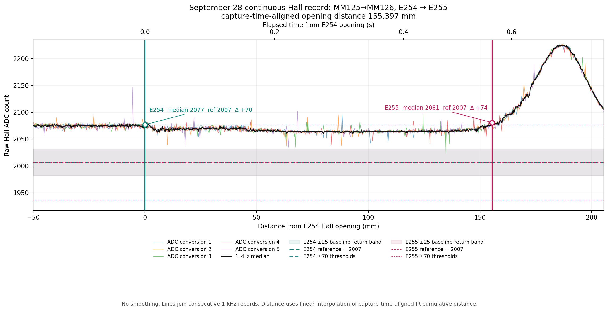
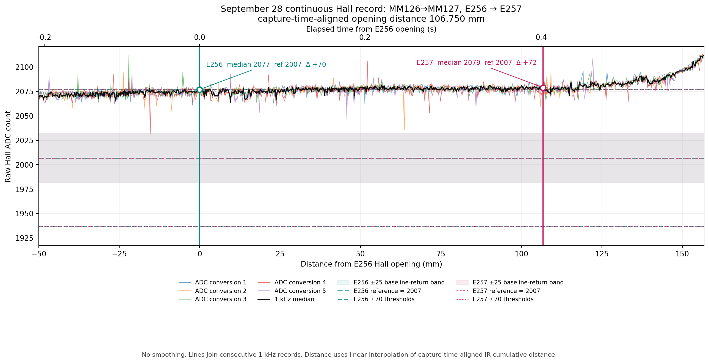

# September 28 raw Hall waveforms: events 254–257

## Result

The 1 kHz Hall median did **not** return to its event reference's ±25 ADC baseline-return band between either requested pair of openings. There was no sustained five-conversion return either: events 254→255 contain one isolated conversion inside the band, while events 256→257 contain none. The median remained on the positive side of the recorded 2007 reference throughout both intervals.

This does not establish that two physical magnetic fields overlap. It establishes only that the recorded ADC signal remained displaced from the event reference between these openings.

| Requested interval | Event pair | Direction | Opening distance | Elapsed time | Recorded references | Median between openings | Median returned to ±25? |
|---|---:|---|---:|---:|---:|---:|---|
| MM125→MM126 | 254→255 | CW | **155.397 mm** | 570.000 ms | 2007 / 2007 | 2060–2081 (`+53` to `+74`) | **No** |
| MM126→MM127 | 256→257 | CW | **106.750 mm** | 401.998 ms | 2007 / 2007 | 2064–2081 (`+57` to `+74`) | **No** |

For reference 2007, the positive opening threshold is 2077, the negative opening threshold is 1937, and the baseline-return band is 1982–2032. Because both events in each pair recorded the same reference, their separately drawn reference, threshold, and baseline-band marks coincide in the plots.

## MM125→MM126: events 254→255

The median dropped below the `+70` opening threshold after event 254. It was inside the closed-threshold region for 564 of the 571 records, in three runs; the longest run contained 558 samples and spanned 556.718 ms and 151.551 mm from its first to last sample. The median never approached the baseline band: its closest value was 2060, still 53 counts above reference.

Among the 2,855 individual conversions between and including the two opening records, one isolated conversion was 2023, 16 counts above reference and therefore inside the ±25 band. It occurred 490 ms and 134.747 mm after event 254. The other conversions in that 1 kHz record and its median did not make a baseline return. This is a single-conversion excursion, not a sustained return of the measured signal.

## MM126→MM127: events 256→257

Here the median fluctuated close to the positive opening threshold. It was below the threshold for 115 of 403 records, split into 48 short runs. The longest run contained 16 samples and spanned 15.010 ms and 4.346 mm from its first to last sample. Its closest median value was 2064, 57 counts above reference.

None of the 2,015 individual conversions entered the ±25 baseline band; the closest raw conversion was 2036, 29 counts above reference. The median also never entered the band.

## What the measurements show

The detector can close and produce a later two-sample opening without the ADC returning to the ±25 baseline band. In events 254→255 the below-threshold separation is long and mostly continuous. In events 256→257 it is short and fragmented because the median repeatedly crosses around `reference + 70`. A threshold closure is therefore distinct from a baseline return in both records.

No waveform shape or field superposition model was fitted. Event 254 and event 256 were recorded as `NON_LANDMARK_HALL`; event 255 and event 257 were recorded as `ADVANCED`. Those navigation classifications do not change the raw-signal finding above.

## Method and limitations

- Each colored trace is one of the five stored ADC conversions; the black trace is the stored 1 kHz median. No smoothing was applied.
- Each view covers exactly 50 mm before the first opening through 50 mm after the second opening. The lower axis is displacement from the first opening. The upper axis maps elapsed Hall-record time onto the same positions without assuming constant speed.
- Opening locations use the matched second qualifying median sample in the event record.
- Distance uses linear interpolation of the IR recorder's cumulative nominal distance at each Hall sample's timestamp after aligning IR by its captured timestamp. The interpolation improves recorder synchronization, but individual IR pulse timestamps were not recorded. The reported millimeter values therefore retain IR pitch, quantization, and interpolation uncertainty and are measurements of nominal odometry rather than independently demonstrated physical distance.
- The capture records the reference attached to each opening event, not a continuous reference trace. All four requested events report reference 2007, so no adaptive-reference change is evidenced within these two pairs.

## Reproducibility

- [Analysis script](../plot_hall_intervals_254_257.py)
- [Machine-readable metrics](waveform_metrics.json)
- [Tabular metrics](waveform_metrics.csv)
- Source capture: `../sources/otto_navi_sync_20260928_101705.nsr`
