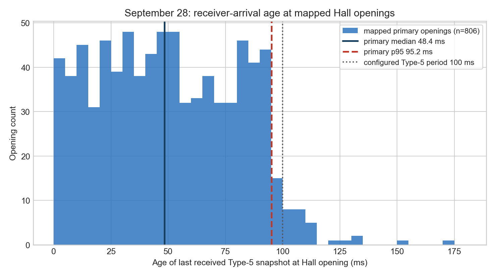

# IR reporting frequency and Hall synchronization review

**Date:** 2026-10-12  
**Repository reviewed:** `ninobur/esp-loco-control`, current review worktree at commit `4ad1df225f3768c192330c634b53d114faabf894`  
**Scope:** source/history review plus read-only remeasurement of the September 28 continuous capture. No firmware, specification, map, or deployment change.

## Finding

NAVI can receive substantially newer wheel-distance evidence on the existing hardware, and part of that work already exists. The Type-5 cumulative position snapshot is still produced every **100 ms (10 Hz)**. Since October 6, the transmitter also has a **Type-6 report generated at every completed optical pulse**, carrying cumulative count, nominal distance, and the original transmitter timestamp. At ordinary speeds, that event stream is roughly 11 Hz at 20 pKPH and 25 Hz at 45 pKPH. The current NAVI 0.3 candidate receives Type 6, but uses its timestamp only to assess pulse-timing credibility; it still locates a Hall opening with a Type-5 snapshot selected by **receiver arrival time**.

Thus the timely evidence is present in the candidate architecture, but it has not yet been used to place the Hall opening. Neither the current NAVI 0.3 candidate nor transmitter 1.8 is field accepted. The only current-load Type-6 field run showed promising physical timing and **32.33% receiver-observed sequence discontinuity**, so reliable current-load delivery at 20 or 10 ms has not been demonstrated.

For a fixed periodic Type-5 stream, **50 ms is the fastest interval supported by field delivery evidence**: the older 72-byte unicast implementation delivered 144,009 packets with 50 ms median interarrival, 56 ms p99, 87 ms maximum, and 54 gaps (0.04%). That evidence does not prove the larger, broadcast, mixed-traffic current transmitter will retain the same reliability. There is no field basis for choosing 20 or 10 ms. The better path to pulse-level timeliness is the already implemented event-driven cumulative Type-6 stream, plus a slower heartbeat/snapshot, rather than sending unchanged position periodically at 50–100 Hz.

## What “reporting frequency” means now

The current canonical transmitter is `IR_SCOPE_ESPNOW_PULSE_EVENT_TX_1_8_TRANSPORT_TEST`. It has several independent streams:

| Stream | Production rule | Nominal rate | Position/timing content | NAVI 0.3 use |
|---|---|---:|---|---|
| Type 1 raw waveform | 96 samples at approximately 1 kHz | approximately 10.4 Hz | raw ADC/detector diagnostics | not Hall geography |
| Type 5 cumulative snapshot | `nextReport = us + 100000` | 10 Hz | cumulative pulses, nominal µm, transmitter `capturedUs` | Hall coordinate and normal cumulative movement |
| Type 6 completed-pulse event | detector `fall`; no report timer | speed dependent | cumulative pulses/µm, original `completedUs`, preceding pulse interval | pulse-timing credibility only |
| Type 7 transport status | at least 1,000 ms since prior status | 1 Hz | cumulative transport diagnostics | diagnostics |

Type 5 and Type 6 carry the installed **9.652 mm/pulse** scale. The 100 ms Type-5 interval is an explicit scheduler choice, not an ADC, ESP32, or detector limit. Its one-slot queue retains the latest pending snapshot, so radio congestion can supersede an older unsent snapshot. Type 6 in 1.8 has a 32-entry FIFO and is serviced before Type 5; all sends share a serialized `esp_now_send()` path that may wait as long as 100 ms for its callback. Raw, fusion, observation, retry, and status traffic share that radio task as well.

An October 7 alternate branch, commit `ec1bfa6`, implements `IR_SCOPE_ESPNOW_CUMULATIVE_TX`: Type 5 remains 100 ms, while Type 6 becomes a one-slot latest cumulative event and Type 7 is removed. It trades lossless event history for freshness and bounded backlog. It is not the canonical transmitter on the reviewed current branch and was not field accepted.

## Relevant sketch sequence

| Date / sketch | Status | Distance report interval | Synchronization or Hall association |
|---|---|---|---|
| Legacy `IR_TEST_CAR_ESPNOW_1_0` | August field implementation | **50 ms**, 20 Hz, 72-byte unicast | packet carried sender capture time; the legacy receiver primarily used local arrival/projection behavior |
| `IR_SCOPE_ESPNOW_ACTIVE_TX_1_6_R2` | flashed to the IR car September 23; source used by the September 28 architecture | **100 ms Type 5**; no Type 6 | original transmitter `capturedUs` included in Type 5 |
| September 28 `NAVI_COHERENCE_0_6_POSITION_STATIONS_R1_20Q3_SYNC_R1` | recorded in Otto’s September 28 log; not field accepted | receiver only | estimated transmitter-to-NAVI clock offset as the minimum observed `arrivalUs - capturedUs`; selected the historical snapshot whose aligned **capture time** was nearest the Hall event, with a 150 ms diagnostic alignment gate |
| `IR_SCOPE_ESPNOW_PULSE_EVENT_TX_1_7_TEST` | flashed and field tested October 6 | 100 ms Type 5 + one Type 6 per completed pulse | Type 6 preserves the original completion-sample timestamp; receiver field run exposed sequence discontinuity |
| `IR_SCOPE_ESPNOW_PULSE_EVENT_TX_1_8_TRANSPORT_TEST` | current canonical source; built/reviewed/host-tested, not flashed | 100 ms Type 5 + pulse-event Type 6 + 1 s Type 7 | same Type-5/6 measurement timestamps; Type 7 adds transport counters |
| October 7 alternate `IR_SCOPE_ESPNOW_CUMULATIVE_TX` | alternate branch candidate, not field accepted | 100 ms Type 5 + latest pulse-event Type 6 | one-slot newest cumulative endpoint; receiver derives elapsed count/time between accepted endpoints |
| `NAVI_EWO_0_1_MM045_STOP` | operational foundation, with incomplete/current-field-acceptance qualifications in repository status | receiver only | consumes latest Type 5; freshness is based on NAVI receive time; no clock-domain alignment at Hall |
| `NAVI_EWO_0_3` | current review candidate, built and host-tested, **not field accepted** | receiver only | records Type-5 boundaries at NAVI `receivedUs`; Hall lookup takes latest same-boot arrival at or before Hall time, up to 1 s old. Type 6 informs credibility, not Hall distance |

The important sequence change is that September 28 tried to use the packet’s original capture time after estimating a clock offset. Current NAVI 0.3 instead makes the Hall association causal and reproducible in one clock domain: it stores the cumulative coordinate at callback arrival and refuses to let a packet arriving after the Hall sample move that opening’s anchor. This prevents later-packet substitution, but it also attaches the coordinate to radio arrival rather than to when the IR measurement occurred.

## How old the distance is at a Hall opening

Three quantities must remain separate:

1. **Configured production period:** Type 5 is nominally 100 ms.
2. **Delivery latency:** time from transmitter capture through queue/radio to NAVI callback.
3. **Effective measurement age at Hall:** time from the measurement represented by the selected packet to the Hall opening.

The current code can measure receiver-arrival age, but it cannot directly compute Type-5 capture-to-arrival latency because the two ESP32 uptime clocks are unsynchronized. The September 28 receiver estimated an offset from the minimum observed arrival-minus-capture difference. That method combines unknown one-way delay with clock offset and drift; its own source calls the 150 ms limit a diagnostic alignment gate rather than a measured error bound.

The continuous recorder contained 33,264 Type-5 packets over 3,377.126 seconds. It distinguishes the configured schedule from observed receipt:

| September 28 Type-5 quantity | Median | p95 | p99 | Maximum |
|---|---:|---:|---:|---:|
| transmitter capture interval | 100.000 ms | 100.999 ms | 200.000 ms | 501.000 ms |
| NAVI receiver-arrival interval | 96.707 ms | 116.703 ms | 192.000 ms | 520.951 ms |

There were 435 forward sequence gaps comprising 484 missing sequence positions. Arrival intervals can be shorter than 100 ms when a delayed packet and the following packet arrive close together. Neither interval distribution is an end-to-end latency distribution.

I remeasured all 951 September 28 Hall events using the **current-style causal rule**: select the last Type-5 packet whose NAVI arrival was at or before the Hall sample. For the 806 mapped primary openings:

| Receiver-arrival age at Hall | Result |
|---|---:|
| minimum | 0.148 ms |
| median | **48.419 ms** |
| 95th percentile | **95.213 ms** |
| 99th percentile | 111.694 ms |
| maximum | **174.881 ms** |

Across all 951 events, 28 used a last arrival more than 100 ms old and two exceeded 150 ms. This is phase/stall/loss evidence, not capture-to-arrival latency. If the September 28 capture times are mapped with one global minimum offset, the apparent selected-measurement age is 100.0 ms median and 152.9 ms p95, but the raw clock offset changed by about 94 ms across the recording. Those apparent ages therefore cannot be reported as measured end-to-end latency.

Under healthy 100 ms periodic delivery, the current NAVI Hall coordinate is normally behind by zero to roughly one period plus transport time. Its freshness bound permits a boundary up to **1 second** old, so a missing run of packets can produce much greater age while remaining formally applicable. At 20 and 45 pKPH, 100 ms of motion is approximately 10.7 and 24.2 mm respectively. That is separate from the 9.652 mm pulse quantization and from wheel-scale physical accuracy.

## Timestamp semantics in current NAVI

Current NAVI does **not** use the Type-5 packet’s original `capturedUs` to locate the Hall opening. The receive callback stamps the frame with NAVI-local `esp_timer_get_time()`. `observeIr()` validates that `capturedUs` is increasing, but stores the boundary as `{receivedUs, nominalUm, bootId}`. `irBoundaryAt(hallUs)` selects the latest boundary with `receivedUs <= hallUs` and age no greater than 1,000,000 µs.

Type 6 is different: the receiver preserves `completedUs`, and NAVI compares successive transmitter timestamps to assess timing continuity. It does not pass Type-6 `nominalUm` into the Hall boundary lookup. Processing Type 6 before Type 5 and Hall in the main loop reduces software-queue ordering artifacts, but it cannot remove radio delay, and the boundary lookup still excludes a Type-5 frame that arrived after the Hall sample.

## Can it report faster reliably?

**Hardware capacity:** yes, more than 10 position updates per second is plausible. The detector already samples at approximately 1 kHz. The legacy system demonstrated 20 reports/s over ESP-NOW, and the Type-6 field run delivered thousands of speed-dependent pulse events.

**No reliability compromise:** not established for the present traffic mix. The legacy 50 ms result used a smaller 72-byte unicast packet. The current transmitter broadcasts 110-byte Type 5 and 61-byte Type 6 alongside approximately 250-byte Type-1 batches and other radio traffic, with serialized callbacks. The first Type-6 field run received 4,983 events but found 2,381 missing sequence positions. Receiver queue drop, bad-length, and instantaneous queue-depth counters were zero, so that run did not localize the loss. Transmitter 1.8 was created to expose that boundary but has not had the required second field run.

Practical ranking:

| Candidate | Assessment |
|---|---|
| **Event-driven per completed pulse** | Best match to when new distance exists; already implemented. About 35–90 ms between events in the reported ordinary moving examples. Needs current-load delivery validation and clock association for Hall geography. |
| **50 ms periodic Type 5** | Fastest fixed interval with historical field support. Reasonable next experimental point; current mixed-load reliability remains unproven. |
| **20 ms periodic Type 5** | No supporting current-system field evidence; duplicates the same cumulative count frequently at lower speeds and increases contention. |
| **10 ms periodic Type 5** | No supporting evidence; 100 Hz is far above the ordinary 11–25 completed-pulse/s information rate and adds traffic without improving 9.652 mm physical quantization. |

Consequently, the fastest **defensible periodic** interval is 50 ms, while the fastest **useful measurement-driven** interval is “on every completed pulse.” Neither should be described as current-field-reliable until the full traffic mix is measured with transmitter and receiver loss/lag counters.

## Estimating distance at the Hall opening without faster Type-5 reports

The Type-6 wire data are sufficient to improve the estimate without making Type 5 faster:

- Every accepted event states the cumulative completed-pulse count, `nominalUm`, and the completion sample’s original transmitter timestamp at approximately 1 ms sampling resolution.
- The last completed pulse before a Hall opening gives a causal lower endpoint. The next completed pulse can bracket the Hall opening to one 9.652 mm interval if NAVI waits for it.
- A fractional estimate inside that interval can be formed from surrounding pulse times or a local velocity estimate, but it is interpolation, not a measured pulse count. Acceleration, stops, slip, optical missed cycles, and sampling phase determine its error.

Two limitations prevent an “exact” present implementation:

1. Hall timestamps are in NAVI’s clock and completion timestamps are in the IR transmitter’s clock. A clock-offset/drift model or explicit time synchronization is required. The September 28 minimum-offset method is useful for offline alignment but does not measure one-way latency and drift independently.
2. A completion generated before the Hall opening can arrive afterward. It cannot be used in a real-time Hall judgment unless NAVI defers that judgment. Bracketing with the next pulse necessarily adds one pulse interval of decision delay.

This method can reduce temporal staleness and bound the opening to a pulse interval. It cannot prove the physical center of that interval or correct wheel slip, scale error, or undetected optical cycles. The repository’s 9.652 mm value is a configured nominal pitch; these communications tests demonstrate precision and timing, not independent physical distance accuracy.

## Answers to the seven questions

1. **Current frequency:** Type 5 is 10 Hz by a 100,000 µs scheduler; Type 6 is event driven by completed wheel pulses; Type 7 diagnostics are 1 Hz; Type 1 raw batches are about 10.4 Hz.
2. **Change since September 28:** Type 5 stayed at 100 ms. Type 6 added immediate cumulative pulse events, then Type 7 transport truth; an alternate branch replaced Type-6 FIFO history with a newest-value slot. NAVI changed from capture-time/minimum-offset nearest-snapshot association to arrival-time, last-before-Hall association, while using Type 6 only for credibility.
3. **Age when Hall is evaluated:** current Type-5 position is normally zero to about 100 ms plus transport delay old, but code permits one second. In September 28 data under the current-style rule, genuine openings saw 48.4 ms median, 95.2 ms p95, and 174.9 ms maximum receiver-arrival age. True measurement age was not directly measurable.
4. **Which timestamp:** current Hall geography uses NAVI arrival time. Original transmitter times are checked for Type-5 ordering/speed and used for Type-6 interval credibility, not the Hall coordinate.
5. **Can hardware report faster:** yes in principle; 50 ms was demonstrated under the legacy load. Reliability under the present mixed broadcast load is unresolved and current Type-6 loss is material.
6. **Fastest practical interval:** 50 ms for a periodic Type-5 experiment; per-completed-pulse Type 6 for useful new-distance reports. The evidence does not support 20 or 10 ms.
7. **Exact Hall estimate from counts/timestamps:** it can produce a substantially newer, one-pulse-bounded estimate without faster periodic transmissions. “Exact” requires clock synchronization and, for bracketing, waiting for the next pulse; sub-pulse distance remains inferred.

## Evidence limits and next measurement

- No current canonical transmitter/NAVI 0.3 joint field run exists; source behavior and host tests do not establish radio reliability.
- September 28 had continuous Hall and Type-5 captures but no individual pulse timestamps and no synchronized clocks.
- The legacy 50 ms field result is strong evidence for basic ESP-NOW capacity, but packet size, destination mode, queueing, and traffic load differ.
- The Type-6 field loss figure is receiver-observed; absent transmitter Type-7 records, it does not distinguish producer queue loss, send failure, RF loss, RX loss, serial loss, or logging loss.
- Delivery timeliness should be tested with matching transmitter Type-7 counters, NAVI receive timestamps, Type-5 sequence gaps, and Hall timestamps during a normal full-load run. Tests at 100 ms Type 5 plus Type 6, and then 50 ms Type 5 plus Type 6, would separate the value of the event stream from the cost of doubling the periodic stream.

The current evidence supports substantially more timely IR information, especially through cumulative pulse events. It does not yet support a claim that NAVI can consume 20 or 10 ms periodic reports reliably, nor that it currently places Hall openings with those event timestamps.

## Principal source locations

- Current transmitter cadence and radio sequencing: `firmware/programs/IR_SCOPE_ESPNOW/variants/IR_SCOPE_ESPNOW_TX/IR_SCOPE_ESPNOW_TX.ino`
- Type-5 wire timestamp/count/nominal-distance contract: `firmware/common/IrMovementWire.h`
- Type-6 completion event: `firmware/programs/IR_SCOPE_ESPNOW/variants/IR_SCOPE_ESPNOW_TX/PulseEventEvidence.h`
- Current NAVI Type-5 ingress and Hall boundary lookup: `firmware/programs/NAVI_EWO_0_3/NaviIntegratedCore.h`
- Current NAVI receive callback/order: `firmware/programs/NAVI_EWO_0_3/NAVI_EWO_0_3.ino`
- September 28 synchronization logic: `firmware/programs/NAVI_COHERENCE/variants/NAVI_COHERENCE_0_6_IR_HEALTH/MovementEvidence.h`
- Type-6 architecture and first field result: `docs/NAVI_IR_PULSE_EVENT_PHYSICAL_EVIDENCE_20261006.md`
- Legacy 50 ms delivery evidence: `field-records/20260818_IR_TEST_A_OTTO_PHANTOM_DISCRIMINATION.md`
- October 7 alternate cumulative design: `docs/NGR_IR_COMMUNICATION_SIMPLIFICATION_RECONCILIATION_20261007.md` on commit `ec1bfa6`
