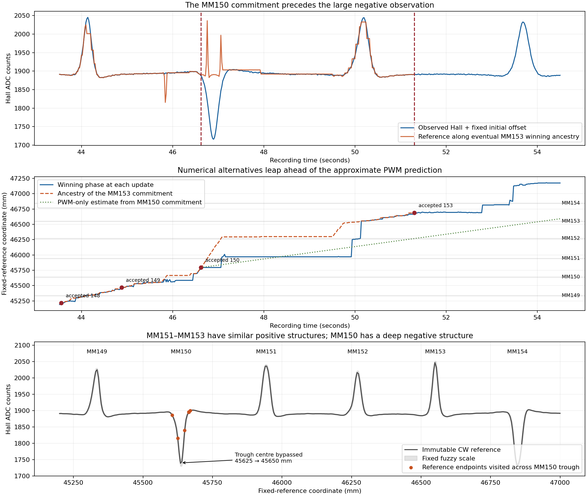

# Why the apparent MM151 piece was placed at MM153

Diagnostic investigation, 2026-10-18. No firmware changes or threshold adjustments.

**The failure began with premature promotion of MM150. An endpoint-only waveform
alignment could skip the reference's main negative trough, linger on its small
positive shoulder, and call that a completed ensemble. Freezing that placement
then removed the paths that were still approaching the real negative observation.
The next positive observation was eventually assigned to MM153 by numerical Hall
cost minimization within that already compromised history. PWM did not prefer
MM153 over MM151.**

## Preservation and method

The failed implementation and exact reported replay remain at
`e50236db472ac419f31e5af72c8f114f9c543232`. Every draft firmware header, the original
replay CSV, and the original results JSON are byte-for-byte identical to that
commit; [preservation.json](../../tests/navi_rvm_manual/forensics/preservation.json)
records their SHA-256 values. Only diagnostic tools, new evidence and this report
were added. No flashing, Pi changes, reference edits, input edits, recognition
threshold changes or recovery mechanisms were involved.

[trace.cpp](../../tools/navi_rvm_manual/trace.cpp) is a separate host translation
unit that exposes private members for inspection without editing the observer.
It executes the preserved observer and independently reconstructs predecessor
selection. It verifies the same winning phase and every retained state's relative
cost, within 1e-5, across all 1,550 recorded blocks. The eventual MM153 path has
665 traceable ancestors. The assertion initially exposed a rounding difference
in the diagnostic adapter's rearranged floating-point expression; the adapter
was corrected to reproduce the original expression exactly. The observer was
never altered. There are no counterfactual threshold runs in this investigation.

The fixture is the original `heldout_cw.csv`, starting at declared MM146 CW.
That historical filename does not make this a fresh holdout. IR fields are not
recognizer inputs. Legacy MM labels are fallible comparison evidence, not surveyed
ground truth. The observations, fixed waveform and executed path nevertheless
establish the mechanism below directly.



## Preceding registration: what the code actually froze

| Accepted label | Recording time | Winning reference coordinate | Frozen coordinate interval |
|---|---:|---:|---:|
| MM149 | 44.879543 s | 45,470 mm | 45,455–45,505 mm |
| MM150 | 46.619709 s | 45,795 mm | 45,780–45,800 mm |
| MM153 | 51.299900 s | 46,690 mm | 46,650–46,740 mm |

MM149 follows the large positive observation at 44.139543 s. MM150 is different:
its fixed reference has a deep negative trough (1738.75 counts at the 45,635 mm
cell). The actual deep negative observation reaches 1713.12 raw counts at
46.899687 s, **about 280 ms after MM150 has already been accepted**. Between
45 s and that acceptance, raw observations range only about 1884.69–1895.97.
These are observed facts, independent of what the legacy detector called them.

The ancestry ultimately chosen for MM153 crosses the reference trough early:

| Recording time | Reference coordinate | Corrected observed Hall | Reference Hall at endpoint |
|---|---:|---:|---:|
| 45.819554 s | 45,605 mm | 1892.02 | 1886.00 |
| 45.839543 s | 45,625 mm | 1894.58 | 1815.50 |
| 45.859744 s | 45,650 mm | 1894.95 | 1839.25 |
| 45.878406 s | 45,665 mm | 1893.19 | 1895.50 |

The 45,625→45,650 transition never scores the intervening reference cells,
including the trough minimum. The path then repeatedly uses the small shoulder
at approximately 45,665 mm while real observations remain near baseline. Its
MM150 contrast accumulates to 1.081114 and its time-averaged residual becomes
0.182021. Those numbers satisfy the existing acceptance rule even though the
main negative structure was not observed there. Calling this a whole-ensemble
match was incorrect: the implementation permits a partial traversal to qualify.

At 46.619709 s an alternative at 45,605 mm, still approaching the trough,
has relative cumulative cost 3.953233. The selected path at 45,795 mm has cost zero.
The commitment keeps only coordinates 45,780–45,800 with the selected completed
identity, deleting the approaching-trough alternative. The fixed reference was
not rewritten; **an insufficiently supported registration was made irreversible**.
The declared MM150 label therefore cannot be treated as independently trustworthy
history when interpreting the later MM153 result.

## How the later path reaches MM153

On the ancestry eventually selected at the MM153 commitment:

- The MM151 reference region is traversed in 14 observations, 46.619709–46.879548 s.
  Those transitions total 305 mm, against 28.28 mm of PWM prediction. Hall loss
  sums to 102.07: this is poor agreement, not positive evidence of MM151.
- The path then crosses MM152 and arrives in MM153's region at 49.619792 s.
  The MM151 and MM152 mismatches remain in cumulative path costs, but their
  individual completion evidence is replaced as each subsequent seam is crossed.
- The observed positive waveform peaks at 50.199565 s (2041.15 raw counts).
  MM151, MM152 and MM153 all contain positive reference structures. The eventual
  winner places that observation at coordinate 46,555 mm in MM153.
- The reported winning phase switches between pre-existing paths: 45,970→46,250 mm
  at 49.939543 s and 46,270→46,555 mm at 50.139951 s. Those are changes of winning
  hypothesis, not individual physically justified 280/285 mm movement steps.
- At 51.299900 s the terminal MM153 contrast is 3.026365, residual quality is
  0.136090 and the one-cost-unit coordinate envelope is 90 mm wide. The existing
  rule accepts MM153 and freezes its descendants. Neither MM151 nor MM152 was
  reported as successfully observed on that winning path.

From MM150 acceptance to MM153 acceptance the winning coordinate advances **895 mm**
while integrated PWM prediction advances **472.700 mm**. PWM supplied an approximate
movement prior and allowed positive-speed transitions, but it did not establish
or justify the geographic displacement.

## Competing costs at the MM153 commitment

These are the least-cost retained paths at **51.299900 s**, grouped by where they
place the *same observed pulse peak at 50.199565 s*. This avoids confusing a
path's currently traversed ensemble with its last completed-MM label.

Costs are sums of the matcher's dimensionless, capped residual and motion terms
since the MM150 anchor. Lower is better. These three paths descend from the
zero-relative-cost MM150 anchor; the common earlier history cancels. The final
column is the matcher's relative cumulative cost after common normalization.
Small rounding differences come from floating-point accumulation.

| Placement of observed positive pulse | Pulse reference coordinate | Hall cost since MM150 anchor | PWM motion cost | Total | Relative cost |
|---|---:|---:|---:|---:|---:|
| MM151 | 45,940 mm | 312.203496 | 8.625578 | 320.829074 | 89.406021 |
| MM152 | 46,265 mm | 241.347040 | 10.622105 | 251.969144 | 20.546188 |
| MM153 | 46,555 mm | 218.978135 | 12.444826 | 231.422961 | 0 |

**The PWM term prefers MM151, then MM152, then MM153. The Hall-cost component
reverses that ordering.** The winner gains about 93.225 Hall-cost units over the
MM151 alternative while paying about 3.819 additional motion-cost units.
This is numerical preference under a defective waveform alignment score, not
proof that the magnetic landscape geographically identified MM153.

These are conditional alternatives *after the premature MM150 commitment*.
They do not include the intact, still-approaching-MM150 histories deleted at
46.619709 s. The table must not be interpreted as a fair comparison starting
from the last sound registration at MM149.

For completeness, grouping by **last completed label** instead gives minimum
relative costs MM151=21.566956, MM152=0.024476 and MM153=0. This is a different
question: the near-tied completed-MM152 endpoint at 46,665 mm already places the
observed pulse in MM153 but has not crossed its following seam. It is not an
independent MM152 geographic interpretation. The code discards it when it freezes
MM153, despite it being within the one-cost-unit envelope. Full pre-pruning costs
are in [commitment_costs.csv](../../tests/navi_rvm_manual/forensics/commitment_costs.csv).

## Causal defects in the existing mechanism

1. **Endpoint-only emission permits unaccounted reference traversal.** Each
   observation is scored only against its destination cell, even when a transition
   crosses several fixed-reference cells. Missing the reference trough's middle
   incurs no direct penalty for those omitted cells.
2. **Cheap elastic traversal and repeated shoulder credit distort evidence.**
   The motion discrepancy term caps at 0.16 per update. The path can compress
   mismatching structures into a few updates and stretch a small matching shoulder
   across many updates. Evidence and mean quality are weighted by observation time,
   not by accounting for the full geographic waveform traversed.
3. **Local completion becomes trusted history too early.** Seam crossing stores
   the just-completed segment's summary; acceptance examines that summary and a
   narrow relative-cost envelope. It does not establish that the whole ensemble
   was represented, or that geographic alternatives retain coherent earlier fits.
   Freezing that decision eliminates useful alternatives. This first damages the
   history at MM150, then promotes MM153 under the damaged history.

The cumulative DP costs are genuinely retained, and accepted coordinate intervals
genuinely constrain descendants. Neither property cures the scoring defect:
constraining later fits with a falsely accepted piece protects the wrong placement.
There is no evidence that integer MM counting itself added three, that the map
was shifted, or that a direct PWM-distance-to-MM conversion made this decision.

## Smallest coherent correction — proposed only

The continuous matcher can plausibly be corrected **within its existing basic
architecture**: immutable fuzzy reference, persistent sequence alignment, signed
Hall evidence and soft PWM context. This diagnosis does not prove a corrected
version will succeed on the track.

The required correction is to its **waveform traversal accounting and consequent
registration promotion**, not an added detector or recovery layer:

- Score the reference span traversed by a transition, including the waveform
  structure between endpoints, using the observation's sampling/averaging support.
  If observations cannot resolve or support that span, represent it as unobserved
  or mismatched coverage within the same alignment. Crossing it must not earn
  evidence that a complete ensemble was observed. A fixed reference part may be
  missing; its geographic place must still remain on the board.
- Accumulate matching support against the reference portion actually covered so
  dwelling on a small shoulder cannot substitute for observing the main waveform.
  Make registration promotion use that same continuous, history-consistent fit
  and its geographic alternatives. A low terminal-segment score or narrow cluster
  left after elimination cannot by itself establish a new trusted piece.

These two aspects belong together: better transition accounting must feed the
same geographic commitment decision. Merely widening the band, raising an evidence
threshold, adjusting a PWM penalty, forcing the next integer MM, adding polarity
acceptance gates, or averaging the last few segment qualities would not correct
the demonstrated defect. Nor should the correction make every magnet mandatory:
a genuine missing ensemble must remain a gap while later observations retain
their fixed reference identities.

An authorized implementation should first rerun this unchanged failure and inspect
whether the MM150 trough can still be bypassed and promoted, then compare the
MM151–MM153 alternatives with the MM149 registration retained. No correction,
threshold change, or counterfactual firmware variant has been implemented here.

## Reproduction

From the repository root:

```sh
c++ -std=c++17 -O2 -Wall -Wextra -Werror \
  -Ifirmware/test-programs/NAVI_RVM_MANUAL_1_0 \
  tools/navi_rvm_manual/trace.cpp -o /tmp/navi-rvm-trace
/tmp/navi-rvm-trace tests/navi_rvm/fixtures/heldout_cw.csv tests/navi_rvm_manual/forensics
python3 tools/navi_rvm_manual/plot_trace.py
```

The trace checks phase and costs before reporting. `frames.csv` contains the live
winner at each update; `path_to_153.csv` contains its eventual selected ancestry,
which is not necessarily the earlier live winner. `reference.csv` contains the
unchanged fixed reference excerpt. `anchors.csv` contains the accepted coordinate
registrations. Plotting requires matplotlib and changes no recognition inputs.
