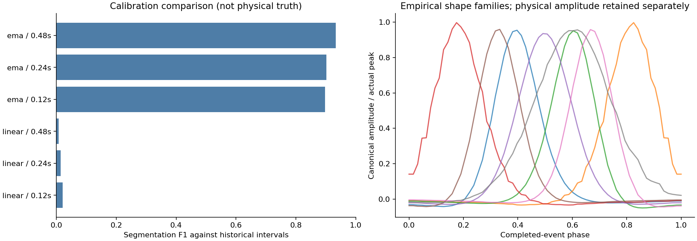
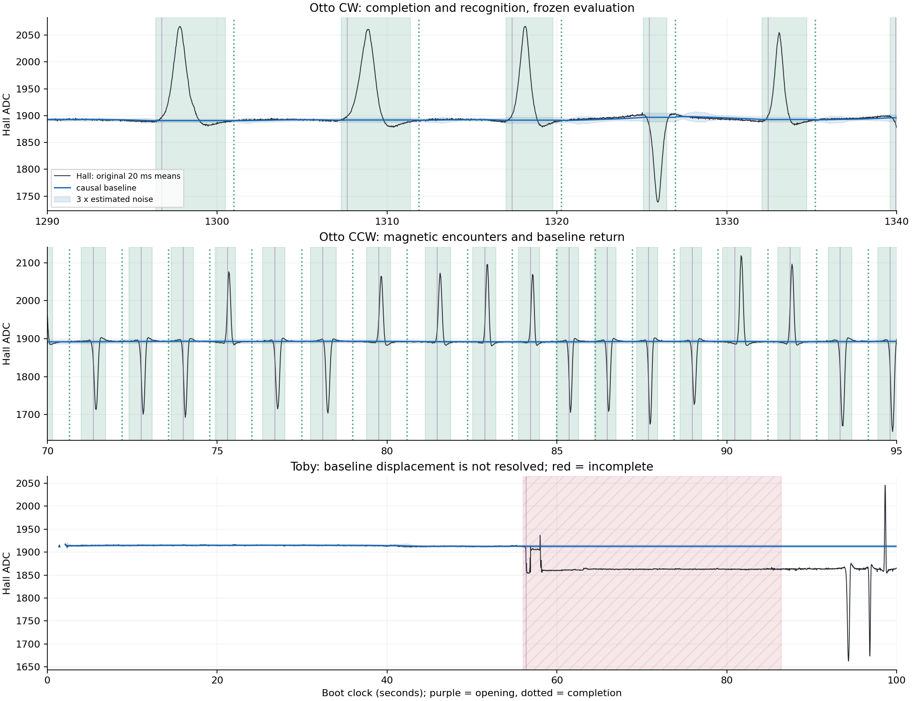
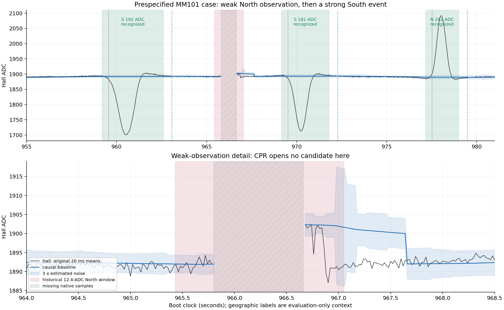
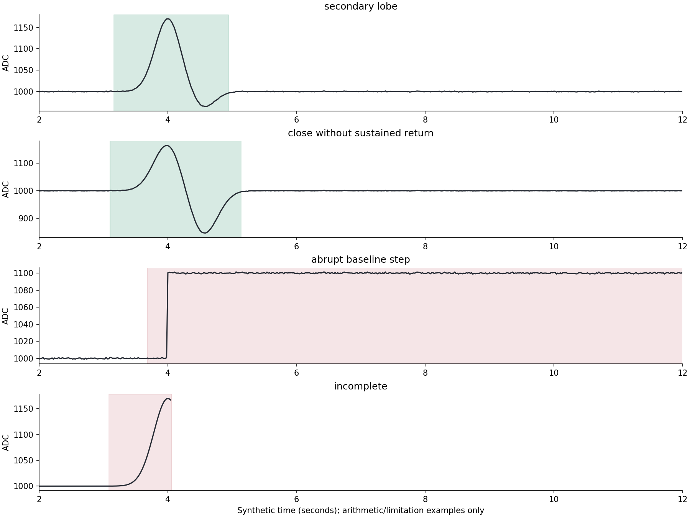

# NAVI_CPR_0_1 — evidence and recommendation

19 October 2026. **The offline experiment is implemented and reproducible, but
the present model is not supported for locomotive integration.** Complete-event
recognition without geography works on many Otto passages. Baseline handling,
completion and weak-pattern generalization remain inadequate. The known MM101
false-North case is inconclusive because its native recording is interrupted.
No firmware or governing specification was changed, and no device was flashed.

## What was delivered

The independent Python reference implements Trace → Discover → Complete →
Recognize. It records provisional openings and estimated starts, completed
boundaries and decision times, physical features, native 70-count witnesses,
recognized/unrecognized completed objects, all scores and incomplete candidates.
Baseline estimation, segmentation/completion and statistical recognition have
separate classes and tests. There is no fixed-width candidate scan or competing
nonmagnet class. The [architecture reconciliation](ARCHITECTURE.md) documents
conflicts with appearance-based RVM commitment and unresolved integration choices.

The [clean source](cpr.py), [runner](experiment.py), [tests](test_cpr.py),
[reproduction instructions](README.md), [protocol](PROTOCOL.md), native input
packs, plots and machine-readable evidence are included. The result is a
negative/inconclusive research assessment, not a field acceptance claim.

## Repository isolation and provenance

Repository: `ninobur/esp-loco-control`. Local checkout:
`/Users/davidbrown/NGR/NGR-Files/navi-cpr-0-1`.
Branch: `research/navi-cpr-0-1-20261019`.

| Checkpoint | Commit |
|---|---|
| Current October 19 research/delivery base, preserved rollback point | `9e7b9208df1e9e06f75f208cd8a39fcec6b62cc7` |
| Assignment, scope, partitions and numerical protocol before implementation | `f9cc949` |
| Components and tests before calibration | `f8476e9` |
| Calibrated model and results frozen before CCW/Toby evaluation | `eeec67a` |

The older main local checkout had unrelated edits and was left intact. The
isolated branch starts from the current October 19 manual-recognizer research,
which descends from remote main `94062cd`. All new/modified tracked files are
inside `research/NAVI_CPR_0_1/`. No governing record is amended. Older independent
research was read at its own commits, not merged into firmware.

The source investigation covered the operator-metaphor compendium; audit
F01/F02/F06; the stopped RVM manual draft; the independent normalized-shape,
70-ADC and whole-ensemble experiments; the October 19 continuity-manual delivery;
and the later implementation-versus-intention review. Their distinctions and
source identifiers are in ARCHITECTURE.md. The three external mathematical
investigations were available only through the assignment's summary; none of
their claimed performance was adopted.

### Actual recording inputs

Read-only SSH access to `david@192.168.68.142` (`ngr-pi`) worked. The Pi MQTT logs
are in `/home/david/NGR/telemetry/runs/`. Native Hall is in
`/home/david/NGR/navi_sync/navi_sync_20261015_100403.nsr`.
The fixed capture slice is bytes **8,652,695,604 through 9,281,594,685 exclusive**:
628,899,081 bytes, SHA-256
`a2b364546317c984fdc571d08b4e514e54e2a48d1302465e3bc854778ad573a6`.
All **750,651 frames validate**; zero CRC-invalid frames and zero trailing bytes.
Valid frame CRCs do not imply complete sample delivery.

| Input | Native samples | Duration of derived tracing | Missing 20-ms bins | Role |
|---|---:|---:|---:|---|
| Oct 15 Otto boot `15549e9385faa4d5`, 100–1800 s only | 8,468,560 | 1700.00 s | 359 | Construction, inside the prior construction partition |
| Oct 19 Otto CW `D004D9A3888E8394` | 9,982,608 | 1996.74 s | 14 | First 60% calibration; remaining 40% evaluation |
| Oct 19 Otto CCW `3B1BE1D923CB81FD` | 9,263,952 | 1853.78 s | 54 | Evaluation and prespecified MM101 case |
| Oct 19 Toby CW `6A31DD995673D123` | 3,536,160 | 707.90 s | 36 | Cross-locomotive evaluation |

CW comparison combines run 10 and its run-11 continuation in the same boot.
The evaluation cut is recorded exactly in models.json. Evaluation starts a new
causal observer and incurs its warmup; no calibration state leaks across the cut.
Data-crossing boundaries are not borrowed for fitting. October 15 boot
`4d8083de79a0e299` remains reserved and was **not read or replayed** here.

These recordings were examined by earlier investigators; none is a blind field
holdout. October 15 boundaries are existing ADC-only activity annotations with
historical opening/sequence identities. October 19 boundaries are outputs of the
previous fixed-width recognizer, not independently verified complete magnetic
fields. The CCW denominator includes its known false North observation and 79
observations without a geographic claim. Toby's historical observer lists only
46 objects and is itself known to have incomplete coverage. A route success is
never promoted to physical label truth in this report.

The manifest records source paths, hashes, source row bounds, serial jumps,
clock offsets and comparison provenance. Four lossless native-column packs
(about 51 MB total) reconstruct the exact original native bytes, verified by
SHA-256. Native PWM/direction fields are retained for byte provenance only;
recognition never reads them. Native loss remains missing data, never filled.

## Component and recognition comparison

All six alternatives were evaluated on construction/calibration only. Selection
used calibration segmentation F1 at one-to-one IoU >=0.3 against the historical
intervals. These are deliberately **proxy criteria**, not physical completeness.

| Baseline | Return persistence | Training matches / 378 | Calibration matches / 282 | Calibration F1 proxy |
|---|---:|---:|---:|---:|
| Robust local-linear | 0.12 s | 230 | 3 | 0.0211 |
| Robust local-linear | 0.24 s | 160 | 2 | 0.0141 |
| Robust local-linear | 0.48 s | 60 | 1 | 0.0071 |
| Clipped EMA | 0.12 s | 323 | 254 | 0.8975 |
| Clipped EMA | 0.24 s | 321 | 253 | 0.9020 |
| **Clipped EMA** | **0.48 s** | **316** | **260** | **0.9336** |

The frozen local-linear slope can extrapolate away from the actual background
during a long candidate and prevent baseline return/rearming. The EMA alternative
is substantially better under these particular implementations and records.
This does not establish that EMA is the best possible estimator. It fails on
Toby's persistent baseline displacement, and initial warmup can occur off baseline.

The selected segmentation yields 316 unambiguous training objects and 260
calibration objects. The recognizer preserves actual amplitude, duration, SNR,
polarity, asymmetry and opposite-area fraction beside an area-integrated 64-phase
curve. Both time orientations are represented without reading travel direction.
The alternatives are eight empirical shape families with amplitude/duration;
eight-PC shape coordinates plus reconstruction error and physical features with
shrunken covariance; and a moment-fitted Gaussian shape with amplitude/duration.
The Gaussian is a comparator, never the assumed universal target shape.

Each threshold is the 99th percentile of positive calibration distances:
PCA/covariance **80.9852309240**, template **19.0303764091**, Gaussian
**16.5588378546**. These are one-class distance cutoffs, not probabilities or
false-positive guarantees. The models were frozen before evaluation and were
not retuned after examining failures.

### Segmentation evaluated separately

| Evaluation recording | Completed objects | Historical objects | One-to-one matches | Unmatched historical objects | Unmatched CPR objects | Split / merge proxy |
|---|---:|---:|---:|---:|---:|---:|
| Otto CW, evaluation portion | 75 | 76 | 75 | 1 | 0 | 0 / 0 |
| Otto CCW | 563 | 703 | 528 | 175 | 35 | 0 / 5 |
| Toby CW | 0 | 46 | 0 | 46 | 0 | 0 / 0 |

There are respectively 1, 4 and 1 incomplete candidates. Zero split proxies
does not prove correct lobe ownership; a persistent-return rule can merge
closely spaced encounters. Events whose boundaries fail IoU can also fail a
match despite overlapping real structure. Detailed first mismatches are retained
in evidence_audit.json. No failed objects or historical rows were removed to
improve the reported result.

### Whole-object recognition evaluated separately

The entries below are **recognized objects / matched historical objects**.

| Frozen recognizer | Otto CW | Otto CCW | Toby |
|---|---:|---:|---:|
| PCA/covariance + physical features | 72 / 72 | 542 / 523 | 0 / 0 |
| Empirical templates + amplitude/duration | 70 / 70 | 554 / 528 | 0 / 0 |
| Gaussian fit + amplitude/duration | 69 / 69 | 555 / 528 | 0 / 0 |

PCA's historical-match proxy is 72/76 CW and 523/703 CCW. Template and Gaussian
retain all 528 segmented CCW matches while accepting more unmatched objects.
Those differences do not establish a physical accuracy winner. Recognition
scores and reasons implicit in the native-witness/distance decisions are retained
for **every completed object**, including rejected ones.

PCA has 19 unmatched CCW recognitions over 1852.70 observed seconds:
**36.92 unmatched recognitions per recorded hour**. That is **not a measured
false-positive rate**: the labels are incomplete and fallible, and the events
have not all been physically adjudicated. CW has zero unmatched recognitions in
798.70 seconds, likewise not a field false-positive guarantee. The available
construction-only background labels cover 1281.52 s and contain zero wholly
background-contained PCA recognitions; this is not a held-out estimate either.
**Independent field false-positive and missed-recognition rates are unavailable.**

### Boundaries, completion and declaration latency

For the 75 CW and 528 CCW segmentation matches, median absolute estimated-start
errors to historical intervals are 0.290/0.290 s; end errors are 0.550/0.130 s.
Starts tend early and ends tend late. The 300-ms prehistory contributes directly
to that start bias; it is retained rather than relabelled as exact field onset.

The selected return condition adds 0.480 s after the estimated return. Median
declaration time relative to the historical end is 1.030 s CW and 0.610 s CCW;
none of those matched declarations precedes the historical end. These are
conditional, retrospective proxy errors, excluding misses, and the historical
window ends are not physical metrology. Independent beginning/ending accuracy
and correct whole-field completion require adjudicated boundary ranges.

The CW example contains shoulders and recovery tails retained in event objects.
The CCW example contains both signs. On Toby, the background shifts from roughly
1915 to 1860 ADC near 56 s; CPR freezes its earlier baseline, reaches the horizon,
and stays unresolved rather than inventing a magnetic recognition. It therefore
misses subsequent genuine-looking excursions. No motor-linked baseline correction
or plateau-compression substitute was added after seeing this failure.

## MM101: what can and cannot be concluded

The Pi MQTT record reports sequence 624 at local **18:19:19.076**, expected MM101
South, observed North. Its prior recognizer reports a 12.4-ADC observation,
window **965.430–967.050 s**, LLR 3.358. The existing architecture review attributes
that acceptance to a likelihood-tail comparison in sparse training space. That
is a prior implementation analysis, not proof of the physical cause of the bump.

The independently copied native recording has missing/censored bins covering
**965.800–966.660 s**, overlapping that window. CPR then warms up until
**967.660 s**, treating the recovering level as unverified initial background.
There is no completed North object, but this outcome is confounded by recording
loss and warmup blindness. **It cannot be counted as successful false-event
rejection.** The cause of the field observation remains unassigned by CPR.

The subsequent South encounter is available and recognized by all three models:
estimated start 969.160 s, end 971.800 s, completion 972.280 s; measured peak
departure 180.559 ADC; native second-sample witness 969.819428 s. This establishes
recognition of that complete observed curve, without a geographic input. It
does not retroactively validate the preceding blank interval.

The MQTT excerpt and its complete-source hash are retained. To answer the false
recognition question decisively requires an uninterrupted acquisition stream
through 965.43–967.05 s, or a separately validated concurrent acquisition source
with its own timing/loss provenance. No interpolation or inferred waveform was
used to manufacture that missing evidence.

## Synthetic checks and disclosed failures

Nine deterministic tests pass: native equality at 70 and detection on sample two;
serial-loss/chunk-boundary confirmation; area preservation across every source
sample; no completion at a principal peak/reversal/secondary plateau; separated
events and both signs; gap/EOF censoring; memory-horizon censoring; prefix
causality; and extended constant background/time-order handling.

The code cleanup preserves the executable AST exactly, excluding added
docstrings. A second complete evaluation replay reproduces all three recordings'
event JSON and chronological journals byte for byte. The native packs reconstruct
all four source byte streams exactly, and the external native-CSV CLI smoke test
passes. See results/verification.json and results/tests.log.

Thirteen additional frozen synthetic examples cover strong and weak encounters,
asymmetry, shoulders, secondary lobes, closely spaced encounters, slow and abrupt
baseline changes, correlated noise, short disturbances, incompleteness and
stationary background. Strong, asymmetric, secondary-lobe, shoulder, slow-drift
and correlated-noise examples each produce complete recognized objects. Results
are arithmetic illustrations, not railway reliability evidence.

The **78-ADC negative synthetic encounter completes and has a qualifying native
witness but PCA rejects it**. A 55-ADC completed candidate remains unrecognized
under the existing 70-count requirement. A close synthetic pair produces one
merged object even in the nominally separated case because 0.48 s sustained
return is not achieved. An abrupt baseline step produces no completed object,
and an interrupted encounter remains incomplete. Stationary noise and the brief
disturbance produce no completed objects. These failures are preserved; no
parameter was changed to make them pass.

## Implementation assessment

The selected online algorithm has bounded event, baseline, prehistory, return and
diagnostic state. It does not store a run or scan arbitrary window lengths.
The maximum observed event buffer is **1519 bins** (the configured 30-s field
limit plus prehistory/onset allowance and the overflow check). Expiration emits
incomplete and waits for baseline return; it never recognizes an overflow object.

On this Apple arm64 host, replay segmentation/native processing costs:

| Evaluation recording | Median ms / 20-ms bin | p99 ms | Maximum ms |
|---|---:|---:|---:|
| Otto CW | 0.0365 | 0.2246 | 13.718 |
| Otto CCW | 0.0360 | 0.2253 | 9.008 |
| Toby | 0.0323 | 0.1117 | 0.494 |

These timings include native confirmation and Python/NumPy host processing, but
exclude separately measured whole-event scoring. Scoring all three alternatives
on 638 completed objects takes median **0.0433 ms**, p99 **0.0739 ms**, maximum
**0.2483 ms** on that host. They are workload measurements, not ESP32 estimates
obtained by multiplying CPU clocks.

A possible compact C representation using 16 bytes/event bin requires **24,304 B**
for that event cap. A 100-point background history is approximately 1.6 KB, the
prehistory/return copies under 1 KB, and all three float32 models approximately
5.3 KB (PCA-only inference can omit the template table). A retained binary
256-row diagnostic ring might add around 10 KB. A rough **32–50 KiB plus queues,
stack and allocator overhead** is plausible; it has not been allocated or measured
in firmware. Python tuples, offline native restoration, full trace arrays,
training and plotting have different and much larger host memory costs.

Native confirmation is O(1) per acquisition sample; EMA is O(1), with robust
background-noise summaries over 100 values every fifth bin. Completion is O(1)
per bin apart from its bounded 24-bin return check. Whole-event phase integration
is O(event length), the shape projection about 8×64 multiply-adds, covariance
distance 14×14, and eight-template comparison 8×64. Training/SVD is offline only.
These bounded costs make eventual embedded investigation plausible. They do not
prove schedulability at 5 kHz acquisition/50 Hz event processing alongside MQTT,
radio and manual control. The earlier delivery's second-scale recognizer stalls
are a reason to demand target profiling, not a performance claim about this code.

## Explicit research-question answers

| Question | Evidence-backed answer / missing evidence |
|---|---|
| 1. Observable beginning? | Three causal residual departures plus prehistory reliably instantiate a provisional candidate in software. They do not establish an exact physical beginning; early bias and baseline contamination remain. |
| 2. Observable end? | Sustained residual return supports an eligible end. 0.48 s gave the best of six calibration proxies, but exact complete-field correctness is unverified and close-pair merging remains. |
| 3. Secondary lobes versus separate magnets? | Following through reversals preserves the tested secondary lobes. Persistence alone cannot resolve all close pairs; independently reviewed field ownership and separation evidence are missing. |
| 4. Best baseline estimator? | Clipped EMA clearly beats this frozen-slope local-linear implementation on calibration. Neither handles all real locomotive baselines; Toby is a decisive failure. |
| 5. Population shape representation? | Empirical families and PCA/covariance represent multiple whole-event shapes with physical features. No physical-truth accuracy winner is established over the Gaussian comparator. |
| 6. Amplitude without excluding legitimate weak fields? | It is retained in ADC units and in the learned joint distribution, with the unchanged 70-count witness. The 78-ADC synthetic rejection shows weak-field generalization is still unsolved; a broader independently labelled weak-magnet population is needed. |
| 7. Recognition without geography? | Yes for many observed Otto objects: no route, direction, PWM or IR enters recognition. Reliable complete-population recall is not demonstrated. |
| 8. MM101 false recognition? | Inconclusive owing to native loss and warmup; following South curve recognized. No invented physical failure diagnosis. |
| 9. False-positive and missed-recognition rates? | Historical-object matches and unmatched/hour proxies are measured above; independently verified physical rates are unavailable. |
| 10. ESP32 feasibility? | Bounded compute/state appear plausible; no target implementation, timing, float32 parity, queue contention or memory high-water test exists. |

## Recommendation and decisions left with the operator

Continue offline evidence work before locomotive implementation. The current
reference does not meet a defensible field-readiness standard: it cannot maintain
baseline awareness across Toby's shift, has unresolved CCW coverage and merging,
rejects a qualifying weak synthetic magnet, and cannot establish physical rates
or the requested MM101 rejection. The class of continuous-event recognition
remains worth investigating; this implementation is not its validation.

Before an implementation proposal, obtain independent event/return annotations
with uncertainty ranges, genuine weak and multi-lobe populations, intact coverage
of the MM101 interval, and fresh run/day separation across locomotives. Then
propose a bounded baseline/completion correction for operator review and freeze
a new protocol before testing it. Do not alter this experiment's thresholds or
labels to hide the preserved failures.

Operator decisions are required for any replacement of operational appearance
timing with completion timing, any interpretation/change of the governing sample
filter/baseline or 70-count rule, the later geographic/trusted-context interface,
and any firmware implementation/deployment. None of those decisions is made by
this report. The current assignment ends with this offline evidence package.
