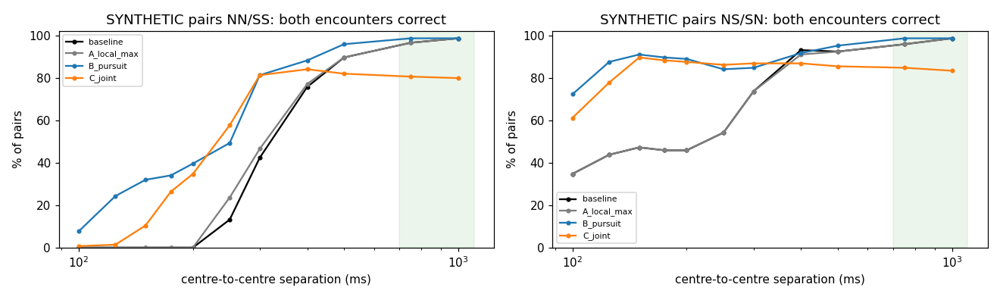
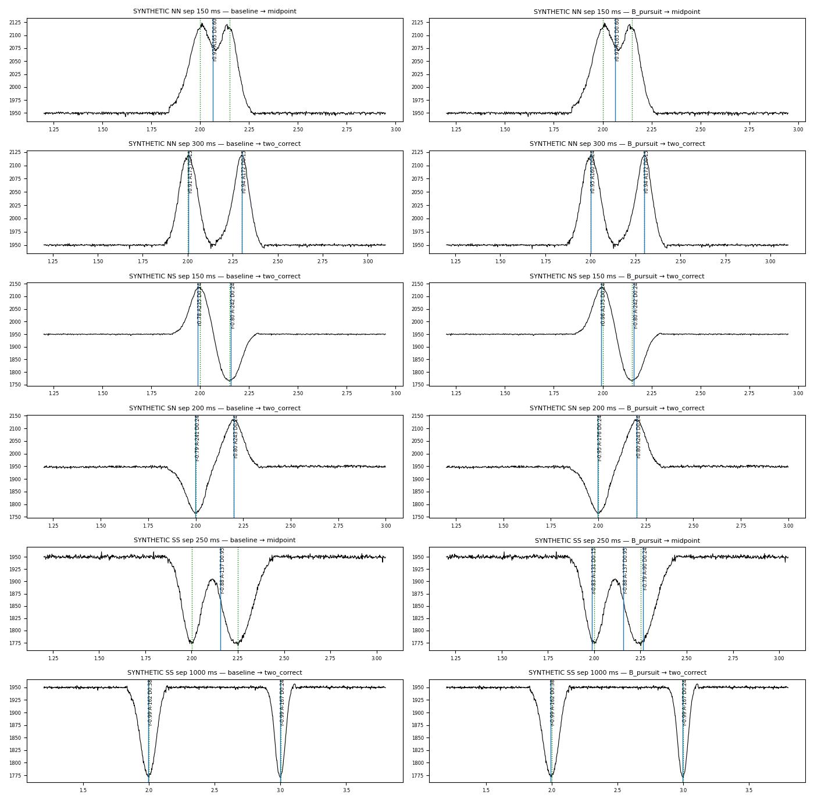

# Continuous magnetic waveform recognition — matched-filter experiment

**Date:** 2026-10-26 · **Author:** Claude (research only) · **Branch:** `research/navi-matched-filter-20261026` (from `research/navi-wolf-pack-20261021` @ `843a975`)
**Status:** research and recommendation. No firmware, NAVI specification, route map or live system was changed. Nothing here is a decision; it is evidence for David's review.

---

## 0. Answers to the three decision questions

1. **Can NAVI recognize individual magnetic waveforms without the absolute Hall baseline?**
   **Yes, on the recorded railway.** A normalized matched filter uses only the samples inside its own window, removing their local mean. It recognized:
   - **99.60 %** of route-placed magnets on held-out Otto data (2,000 / 2,008), with 8 false events.
   - **99.70 %** on Toby (4,007 / 4,019), with 0 false events. Toby was never used for tuning, and the template comes from Otto.

   Constant offsets of ±100 counts change nothing, which is exact by construction. Slow drift (up to ~5 counts/s), noise up to σ 20 and isolated spikes also do not matter. Fast drift (≥ 20 counts/s) and background steps ≥ 100 counts do degrade it, and that is measured in §3.

2. **Can it distinguish successive encounters without a geographic timing gate?**
   **At the separations the route actually produces, yes.**
   - No physically overlapping magnet waveforms were found in any Oct 25/26 recording (§9, Level 4).
   - Synthetic pairs built from recorded waveforms, at the physical separation ratio (≥ ~750 ms at PWM 90), are resolved correctly in 95–100 % of cases with no timing gate.
   - **Closer than ~250 ms, the recognizer fails.** Same-polarity pairs (NN/SS) at ≤ 200 ms are never resolved correctly by any method tested. They merge, or they produce a spurious midpoint event.
   - Opposite-polarity pairs resolve down to 150 ms in clean conditions.

3. **What is the simplest method that succeeds, and what limits confidence?**
   The simplest method is **one template (the 945-curve mean), level-only local normalization, a fixed bank of time scales, and two thresholds** (score |r| ≥ 0.7, fitted amplitude |A| ≥ 70 counts). Events are local maxima with non-maximum suppression. Nothing more elaborate earned its place:
   - matching pursuit helps only in synthetic sub-250 ms opposite-polarity pairs, which the route does not produce;
   - joint two-template fitting was worse;
   - interval-derived scaling failed;
   - local-slope removal created artifacts.

   **What limits confidence:**
   - **Background steps.** Abrupt background steps and noise bursts while moving are the main source of false events. They have magnet-like amplitude, so no amplitude floor removes them.
   - **Map disagreement.** From Oct 26, **MM066, MM067 and MM069 read with the opposite polarity to RouteMap.h**, every lap, on both locomotives.
   - **No early decision.** A causal decision comes about 0.3 s after the waveform peak; no early-decision variant was viable.
   - **Reference quality.** The scoring reference is route-anchored evidence, not physical truth, and it is weakest exactly where the background is disturbed.

---

## 1. What was built

The harness lives in `research/navi_matched_filter/` and runs offline without hardware. See `README.md` to reproduce.

| File | Role |
|---|---|
| `extract_nsr.py`, `navi_sync_format.py` | Decode NSR1 captures (CRC-checked, no repair) to native-sample arrays |
| `mf.py` | Conditioning, template, sliding regression, event extraction |
| `truth.py` | Template-independent reference: excursion oracle + route anchoring |
| `corpus.py` | Partitions and scoring |
| `resolve.py` | Question C methods A/B/C |
| `exp_sweep.py`, `exp_stress.py`, `exp_overlap.py`, `exp_continuous.py` | Experiments |
| `make_figures.py`, `make_manifest.py`, `plots.py` | Figures, manifest |
| `results/` | Machine-readable results; **`event_ledger.csv` is the recognition event ledger** |
| `CORPUS_MANIFEST.md/.json` | Every capture, hash, partition and limitation |

### 1.1 Recognizer (exactly as evaluated)

1. **Despiking.** The native stream (serial order, ~5 kHz in bursts of 5) passes a running **median of 5 consecutive samples**.
2. **Binning.** The result is averaged into 2 ms bins (500 Hz). Gaps up to 20 ms are bridged linearly. A window that touches a longer gap is invalid.
3. **Template.** The template is the mean of the 945 oriented, amplitude-normalized curves in `aligned_curves.csv` (Oct 15 Otto). It is stretched to duration D and padded with D of flat ground on each side, so the window length is 3D. The bank is D ∈ {0.15, 0.24, 0.38, 0.60, 0.95, 1.50} s.
4. **Local normalization.** Inside every window the samples x are regressed on [1, T]: a local level and the template. Two quantities come out:
   - the score r = ⟨x − x̄, T − T̄⟩ / (‖x − x̄‖ ‖T − T̄‖), which is the Pearson correlation;
   - the amplitude A = the least-squares template coefficient, in ADC counts.

   Both are computed only from that window. Nothing is carried from the previous magnet: there is no frozen level, no return test and no expected polarity. sign(A) is the polarity (+ = ADC rises = N on both locomotives).
5. **Events.** Events are local maxima of |r| over time and scale with |r| ≥ 0.7 and |A| ≥ 70. Non-maximum suppression removes weaker maxima within 0.5 D of a stronger one. The reported time is the template-peak position.

**Why level-only rather than level + slope.** Removing a local slope as well ("line") should help with drift. In practice it creates two opposite-polarity sidelobe events about ±175 ms either side of every magnet (r 0.63–0.86, |A| ≈ 80). The slope term absorbs half a bump at the window edge. On development data that is about 2,400 sidelobe events at r ≥ 0.6, and 12–23 extra false events per partition even at the best line setting. The level-only window does not produce them.

### 1.2 Reference: what the recognizer is scored against

The recognizer is never scored against itself. `truth.py` builds a reference without the template:

1. **Excursion oracle.** This is offline and two-sided. The local level is a 4 s rolling median. An excursion is ≥ 30 counts with a peak ≥ 60. It is *clean* when it lasts ≥ 40 ms and the level before and after agree to within 40 % of its amplitude.
2. **Route anchoring.** Polarities of 10 consecutive clean excursions must match exactly one place in `RouteMap.h` (direction from the recorded native `direction`). Anchors are kept only in chains of ≥ 4.
3. **Expected magnets.** A route magnet that two chains skip is *expected* at the time implied by surveyed spacing. This happens only when the skipped count agrees with the local interval within 20 %.

Scoring happens only inside anchored spans. Outside them an event is *unscored*.

- **Recognized:** right position, either polarity. A polarity that disagrees with the map is counted separately (§2.2).
- **False:** inside a span but at no reference magnet.
- **Missed:** a reference magnet with no event.

**Limit:** this is route-consistent evidence, not physical ground truth. Plots show it misplaces anchors where the background steps or bursts (D1EC 64–76 s and 176–192 s, F420 39–102 s). In those stretches some "false" events are real magnets and some "misses" are not real (see `figures/residuals_*.png`). Results are reported as measured, not corrected.

### 1.3 Partitions, fixed before any threshold was looked at

| Partition | Data | Sessions | Reference magnets | Scored s |
|---|---|---:|---:|---:|
| template | Oct 15 Otto, 945 curves (`aligned_curves.csv`) | — | — | — |
| level1 | `9950011_20261025_133357.nsr` (Muse's file) | 1 | 20 | 26 |
| dev | Otto, Oct 25 — **only data used for selection** | 13 | 1,719 | 2,454 |
| validation | Otto, Oct 26 — held out | 6 | 2,008 | 2,650 |
| transfer | Toby, Oct 25 + 26 — held out | 15 | 4,019 | 5,643 |

The corpus has 39 captures and about 5.3 h of native Hall, with 0 CRC errors. Five captures under 50 k samples are excluded. Full list: `CORPUS_MANIFEST.md`.

**Selection rule**, applied to dev only: among configurations with ≥ 99.5 % recall, choose the fewest false + duplicate events, preferring the simpler window and lower thresholds. It chose level-only normalization, pad 1.0, r ≥ 0.7, |A| ≥ 70 (`config.FROZEN`). That configuration was then applied unchanged to validation and transfer.

---

## 2. Headline results (frozen configuration)

| Partition | Recognized | Missed | False | Duplicate | Map-polarity differs* |
|---|---:|---:|---:|---:|---:|
| level1 | 20 / 20 (+2 genuine unscored at the file edges) | 0 | 0 | 0 | 0 |
| dev | 1,715 / 1,719 (99.77 %) | 4 | 7 | 0 | 0 |
| **validation** | **2,000 / 2,008 (99.60 %)** | 8 | 8 | 1 | 34 |
| **transfer (Toby)** | **4,007 / 4,019 (99.70 %)** | 12 | 0 | 0 | 33 |

\*Included in "recognized"; see §2.2.

**Parked data.** Across 4,274 s with PWM 0 (interior of stops ≥ 5 s) there are 7 events. All are in two Otto sessions (D1EC, F420), during start-up disturbances of 70–130 counts while stationary. With the amplitude floor removed there are 41.

### 2.1 What the residual errors are

These were inspected one by one (`figures/residuals_dev.png`, `figures/residuals_validation.png`, `figures/residuals_transfer.png`).

- **Toby, 12 misses.** 9 are magnets whose window touches a **capture dropout**: a UDP loss in the NSR recording, with serial gaps visible. The window is invalid, so no event is possible. On the locomotive those samples would exist. The other 3 are reference ambiguities in the back-and-forth session `22BBF8…`. Toby has **0 false events**.
- **Otto false events.** These are almost all **background steps and bursts while moving or starting**. Examples:
  - a step up and back down within 0.3–1 s looks like a bump (7463C 214.5 s, F420 41.6 s);
  - wide flat-topped ~400-count excursions during the slow crawl in `278F53E8…`.

  Their |A| is 102–390, the same range as magnets, so **no amplitude floor removes them**. Several "false" events in D1EC 186–187 s (PWM 150–165) are, on inspection, **real magnets that the reference mis-anchored**.
- **Otto misses.** These sit in the same disturbed stretches. Several are reference errors: two references 110 ms apart at 8139C 142.3 s, and anchors shifted by one in D1EC 130–150 s.

### 2.2 Field finding: MM066, MM067, MM069 disagree with RouteMap.h from Oct 26

- **Oct 25:** every pass, both directions, matches the map: 66N, 67S, 69N.
- **Oct 26:** in every Oct 26 session the three magnets read with the opposite polarity, **on Otto and on Toby**: 66S, 67N, 69S. That is 34 + 33 recognized passes, all with clean template shapes (r 0.98–1.00). MM068 and the neighbouring magnets are unchanged.

This is **evidence, not interpreted**. I don't know whether magnets were turned or replaced or something else happened. The map was not changed (`figures/field_cases.png`, panel 4).

**Operator explanation (David, 2026-10-27).** Between the Oct 25 and Oct 26 sessions David levelled the ballast in this area because Toby was slipping. That meant removing the magnets and putting them back, and their polarity was not checked afterwards. This is a physical railway change and accounts for the observation. Still open, for David:

- confirm against the actual magnets. Observed on Oct 26: MM066 S, MM067 N, MM069 S. RouteMap.h has MM066 N, MM067 S, MM069 N;
- decide whether to turn the magnets back or change the map.

Neither has been done here.

Consequence for any polarity-sequence navigator: see §10.

---

## 3. Question A — independence from absolute baseline

The configuration is the frozen one, run on the validation sessions (2,008 magnets). Disturbances are added to the recording itself:

- offsets, drift and steps go on the conditioned series;
- noise and spikes go on the native samples, before the median of 5.

The reference is unchanged.

| Disturbance | Recognized | False | Dup |
|---|---:|---:|---:|
| none | 2,000 | 8 | 1 |
| offset +100 / −100 | 2,000 / 2,000 | 8 / 8 | 1 / 1 |
| sine drift ±100, period 60 s / 10 s | 2,000 / 1,998 | 9 / 9 | 1 / 1 |
| sine drift ±100, period 3 s (peak 210 counts/s) | 1,968 | **476** | **366** |
| ramp 5 / 20 / 100 counts/s | 1,993 / **1,965** / **1,815** | 8 / 8 / 53 | 1 / 1 / 38 |
| random steps ±25 / ±50 every ~5 s | 1,999 / 1,998 | 9 / 9 | 1 / 1 |
| random steps ±100 / ±200 | **1,981 / 1,911** | 39 / 48 | 2 / 7 |
| Gaussian noise σ 5 / 10 / 20 | 2,000 / 2,000 / 2,000 | 8 | 1 |
| single-sample spikes 150–400, 2/s and 20/s | 2,000 / 2,000 | 8 | 1 |
| 3-adjacent-sample spikes, 2/s | 2,000 | 8 | 1 |

- **Constant offsets:** exactly invariant.
- **Slow drift, noise, spikes:** robust.
- **Fast drift and large steps:** not robust, and the table quantifies it. A drift whose curvature resembles a bump *is* a bump to a shape detector.

The level + slope window ("line") recovers more magnets under fast ramps (1,930 vs 1,815 at 100 counts/s), but it produces 1,055 false events there. It is not better overall.

**Real field comparison.** On recorded data, the signal between successive magnets failed to return within ±20 counts of the pre-magnet level in:

| Partition | Intervals not within ±20 | Share |
|---|---:|---:|
| dev | 82 / 1,702 | 4.8 % |
| validation | 40 / 1,912 | 2.1 % |
| Toby | 200 / 3,901 | 5.1 % |

Recall of the magnet *following* such an interval:

| Non-return | Recognized |
|---|---:|
| 20–50 counts | 268 / 270 (99.3 %) |
| > 50 counts | 48 / 52 (92 %) |
| ≤ 20 counts (normal) | 7,179 / 7,190 (99.85 %) |

### 3.1 Amplitude measurement (Question D's "how")

A is the least-squares coefficient of the template in the window model x = level + A·T. The level is fitted *in the same window*, so A needs no frozen baseline. The template is peak-normalized, so A is the peak excursion in counts that best explains the window.

A raw window max-minus-mean ("window amplitude") was not used. A burst or a step inside the window inflates it without looking like the template.

---

## 4. Question B — successive encounters (synthetic)

**Library.** 1,645 isolated, clean, route-anchored dev passages: 1,580 at PWM ≥ 85, with median FWHM 114 ms. Only 33 slow passages (PWM 35–70) qualified, with median FWHM 182 ms.

**Construction.** Each passage's contribution is its signal minus a line through its own flanks. Each synthetic trace is a real parked background plus two passages at a centre-to-centre separation, optionally with a 60 counts/s ramp or an 80-count step between them. The factors are:

- polarity NN / SS / NS / SN;
- amplitude equal / half (scaled — a modification, labelled);
- width equal / unequal (an actual slow passage);
- asymmetry same / second time-reversed;
- background stable / ramp / step.

That is 3 random draws × 96 combinations × 11 separations, and **every trace is synthetic**.

Outcome for the plain recognizer (`baseline`), out of 288 per separation:

| sep ms | 100 | 125 | 150 | 175 | 200 | 250 | 300 | 400 | 500 | 750 | 1000 |
|---|---|---|---|---|---|---|---|---|---|---|---|
| two correct | 50 | 63 | 68 | 66 | 66 | 97 | 167 | 243 | 262 | 277 | 284 |
| merged | 181 | 177 | 178 | 178 | 176 | 156 | 73 | 19 | 9 | 3 | 3 |
| midpoint | 48 | 44 | 39 | 39 | 32 | 27 | 47 | 26 | 17 | 8 | 1 |
| none | 1 | 2 | 3 | 5 | 14 | 8 | 1 | 0 | 0 | 0 | 0 |
| duplicate | 0 | 0 | 0 | 0 | 0 | 0 | 0 | 0 | 0 | 0 | 0 |

By factor (two-correct rate, baseline):

| | ≤ 200 ms | 250–500 ms | 750–1000 ms |
|---|---:|---:|---:|
| NN | 0 % | 56 % | 100 % |
| SS | 0 % | 55 % | 95 % |
| NS | 53 % | 79 % | 97 % |
| SN | 34 % | 78 % | 97 % |

The residual failures at 750–1000 ms are almost all cases with the **synthetic step** between the passages, or a half-amplitude second passage. The step edge itself is the "midpoint".

In a clean sub-test (fast passages, equal amplitude, stable background, 40 draws):

- **opposite-polarity pairs** are resolved 80 / 80 at 150, 200, 250 and 300 ms;
- **same-polarity pairs** at 150–200 ms give a midpoint event 76–77 / 80 times with the bank. With a single 240 ms scale they merge or vanish.

**Physical relevance.** Route spacing is 280–355 mm, and the magnet's IR-measured width is about 55 mm. Separation in time scales with speed exactly as width does, so the physical minimum is about 9–10× FWHM. With FWHM ≈ 114 ms at PWM 90, that is the 750–1000 ms columns. The ≤ 500 ms columns are stress conditions the surveyed route does not create.

Location error of correct detections is 4 ms median and 20 ms at the 95th percentile.

---

## 5. Question C — midpoint artifacts without a timing gate

The same synthetic set and the same thresholds were used for all methods. Two-correct counts out of 288 (the A_local_max ≤ 200 ms entries are approximate):

| sep ms | 100 | 150 | 200 | 250 | 300 | 500 | 750 | 1000 |
|---|---|---|---|---|---|---|---|---|
| baseline (local max + NMS) | 50 | 68 | 66 | 97 | 167 | 262 | 277 | 284 |
| **A** local-max selection (discard a wide fit spanning two narrower fits) | ≈ 50 | ≈ 68 | ≈ 66 | 112 | 173 | 262 | 277 | 284 |
| **B** reconstruction (matching pursuit) | 115 | 177 | 185 | 192 | 239 | 275 | 284 | 284 |
| **C** joint 0/1/2-template, BIC | 89 | 144 | 176 | 207 | 242 | 241 | 238 | 235 |

- **A** barely changes anything. The midpoint candidates rarely have qualifying narrower candidates on both sides; the bump pair simply looks like one wider bump.
- **B** is the only method that substantially helps below 300 ms. It does so almost entirely for **opposite polarity** (SN 94 %, NS 78 % at ≤ 200 ms), while SS stays at 19 % and NN at 36 %. It also creates up to 17 duplicates per separation. Cost: one full rescoring per accepted event in a cluster.
- **C**, as implemented, is **worse than baseline at physical separations**: 235–241 / 288 at 500–1000 ms. The white-noise BIC prefers two templates for one real passage, because the recorded noise is correlated. Fixing that needs a noise model, which is more complexity.

**Conclusion.** None of the three resolves close same-polarity pairs. At physical separations the plain recognizer already works (277–284 / 288), and nothing improves it there. The simplest method is the recommendation. This is reported as: *no tested method demonstrates reliable separation below ~250 ms; none is needed at the separations the route produces.*

---

## 6. Question D — minimum amplitude evidence

Development sweep; level-only, pad 1.0. "Floor" is the minimum |A|. Values are recognized / false out of 1,719:

| floor | r ≥ 0.6 | r ≥ 0.7 | r ≥ 0.8 |
|---:|---:|---:|---:|
| 0 | 1,716 / 39 | 1,716 / 20 | 1,712 / 12 |
| 30 | 1,715 / 24 | 1,715 / 15 | 1,712 / 9 |
| 50 | 1,715 / 14 | 1,715 / 9 | 1,712 / 6 |
| **70** | 1,715 / 11 | **1,715 / 7** | 1,712 / 5 |
| 90 | 1,714 / 8 | 1,714 / 6 | 1,712 / 5 |
| 110 | 1,714 / 7 | 1,714 / 5 | 1,712 / 4 |
| 130 | 1,684 / 7 | 1,684 / 5 | 1,683 / 4 |

- **Weak-magnet sensitivity.** Recognized magnet amplitudes are:
  - Otto: 1st percentile 117, median 169, minimum 76;
  - Toby: 1st percentile 142, median 212, minimum 119.

  A floor up to about 110 costs at most one dev magnet. At 130, 31 real Otto magnets are lost. The usable floor range is therefore about **50–110**, and 70 sits inside it. It is not special.
- **False recognition.**
  - In parked noise the floor matters: 41 events without it, 7 with it.
  - While moving, the remaining false events have |A| 102–390, so the floor does not affect them.
  - Muse's 13-count parked wiggle reproduces in kind. The best parked |r| is 0.64 with |A| 9 at pad 0.5, and 0.39 at pad 1.0. It is rejected by any floor ≥ 20.
- **Latency.** The floor does not change latency.
- **Under drift.** The floor does not rescue drift or step cases (§3).
- **Measure.** Use the fitted template amplitude A (§3.1). It is directly measurable in the window and needs no frozen baseline. Peak-to-trough contrast was not used, because it is inflated by bursts and steps.

The selection used dev only. Validation and transfer were not consulted.

---

## 7. Question E — how early can a magnet be recognized?

| Measure | Value |
|---|---|
| Timing of event vs oracle extremum (anchored magnets) | median −2–0 ms, p95 6 ms; worst 118 ms (dev), 218 ms (validation), 36 ms (Toby) |
| Offline score maximum | at the template-peak position by construction (same sample as the reported time) |
| **Causal decision** (window complete + NMS neighbourhood known; greedy, final) | **median 298 ms after the peak**, p95 298 ms; worst 479 ms (dev, Toby), 1,193 ms (validation, slow passage at D = 0.95–1.5 s) |
| Causal recognition, validation / transfer / dev | 1,995 / 2,008 (99.35 %), 13 false, 1 dup · 4,007 / 4,019, 0 false · 1,714 / 1,719, 8 false |
| Early (prefix) template ending at peak + q·D, q = 0 / 0.15 / 0.30 | latency 120 / 156 / 192 ms median, recall ~99.5 %, but **810–1,513 false and ~1,900–2,060 duplicate** events on validation. **Not viable as implemented.** |

**Reproducibility of the geographic reference.** The interval between successive magnet times was compared, for the same magnet pair, across laps at PWM 85–95. That is 656 (loco, direction, pair) groups with at least 4 laps. The spread is the same for:

- the template peak (median SD 92.8 ms, CV 6.8 %);
- the oracle extremum (92.2 ms);
- the threshold onset (93.0 ms).

At this resolution the choice of centre does not matter. Lap-to-lap speed variation dominates.

**Offline versus causal.** Every row above is labelled offline or causal. Retrospective accuracy (99.60 %) is **not** the real-time figure (99.35 %).

The 298 ms latency is mostly the padded window: L/2 = 1.5 D, plus NMS of 0.5 D. Pad 0.5 would cut it to about 0.2 s, at the cost of more false events (Muse-like row, §8).

---

## 8. Question F — does movement information improve recognition?

| Scale strategy | dev | validation | transfer |
|---|---|---|---|
| single fixed 240 ms | 1,710, 3 false | 1,989 (99.05 %), 7 false | 4,007, 0 false |
| 3-scale bank (0.24, 0.6, 1.5 s) | 1,711, 3 | 1,998 (99.50 %), 7 | 4,007, 0 |
| **6-scale bank (frozen)** | 1,715, 7 | **2,000 (99.60 %)**, 8 | 4,007, 0 |
| Muse-like (6 scales, pad 0.5, r ≥ 0.6) | 1,715, 15 | 2,003, 15 | 4,011, 0 |
| interval-derived single scale (D = 0.184 × previous recognized interval; ratio from dev) | 1,404 (81.7 %) | **256 (12.8 %)** | 2,632 (65.5 %) |

- **Interval-derived scaling fails badly** as implemented. One missed or extra event, a stop or a restart corrupts the "previous interval". The scale then goes wrong, and further misses follow. A scale that depends on the recognizer's own output is fragile in exactly the conditions (startup, stops, misses) that matter.
- **A fixed bank** needs no speed estimate and works through acceleration and deceleration, as seen in the Level 1 ramp passages at D = 0.38–0.95.
- Even a single 240 ms scale gets 99.05–99.70 %. The matched filter is tolerant of width, as Muse reported.
- **IR-derived speed was not tested.** IR records were not decoded in this work. PWM was not used as a speed proxy; it does not determine speed (Muse; and the Level 1 ramp needs D = 0.38 at PWM 76).

---

## 9. Independent validation by evidence level

- **Level 1 — `9950011_20261025_133357.nsr`.** **Reproduced:** 22 events, all genuine magnets, **0 false**. Of these, 20 are route-scored and 2 are ramp passages at the file's anchored-span edges (40.865 s S, 72.811 s S), visibly real. Scores are 0.983–0.999 and |A| 164–198. Times and values are in `results/event_ledger.csv` and `figures/level1.png`.
  Muse's leave-one-out template result **also reproduced exactly**: median 0.991, 5th percentile 0.956, minimum 0.771, 945 / 945 > 0.7.
- **Level 2 — other boots, directions, speeds, locomotive.** See §2. Training (Oct 15), selection (Oct 25 Otto) and validation (Oct 26 Otto, all Toby) are separated by recording session.
- **Level 3 — synthetic.** See §3–§5. It establishes algorithmic behaviour only.
- **Level 4 — actual merged-signal field recording.** **Not found.** I did not have the identity (session and time) of the "reported merged encounters", so I searched every Oct 25/26 capture:
  - **No physically overlapping magnet waveforms.** Three anchor pairs with no flat gap were examined; all are reference artifacts in disturbed stretches.
  - **Short gaps.** The only magnet pairs < 0.5 s apart are high-speed running at PWM > 150 in D1EC, with clean baseline between them.
  - **The "no return to the retained level" condition does occur**, in 2–5 % of intervals, caused by background drift and steps. The recognizer recognizes the following magnet in 99.3 % (20–50 counts) and 92 % (> 50 counts) of those cases (§3).

  The missing evidence is the session and time of the reported merged encounters, or a native capture of them. **This work does not claim that the merged-signal problem is solved.** It shows that the recognizer does not depend on baseline return, and that no overlap was found in the archives available.

---

## 10. Geographic interpretation (separate evaluation)

The trackers replay the frozen recognizer's events. Each scored span starts from its first anchor's MM, as if declared. There is no recovery or search, consistent with current NAVI rules. In the table, "genuine" means the event is a reference magnet; a/b/c pairs are dev / validation / transfer counts.

| Model | genuine detected | genuine suppressed by qualification | spurious rejected | confirmations | **incorrect advancements** |
|---|---|---|---|---|---|
| A recognition only | 1,708 / 1,992 / 3,983 | — | — | — | — |
| B + polarity & sequence | — | 24 / 552 / 716 | 3 / 3 / 0 | 1,649 / 847 / 2,525 | **39 / 599 / 742** |
| C + B + reachability (dt ≥ 0.5 × last interval) | — | 255 / 1,219 / 1,804 | 2 / 3 / 0 | 1,299 / 187 / 1,253 | 159 / 592 / 926 |
| strict gate, fixed 0.72 s | — | 67 / 556 / 742 | 5 / 2 / 0 | 1,588 / 843 / 2,481 | 55 / 600 / 760 |
| strict gate, 0.72 × previous interval | — | 476 / 1,456 / 2,468 | 6 / 4 / 0 | 1,119 / 185 / 923 | 114 / 356 / 592 |

Readings:

- **The recognizer finds the magnets; the geographic layer loses them.**
- **Oct 26 desynchronization.** On Oct 26 the polarity-sequence tracker is desynchronized every lap at **MM066/067/069** (§2.2). The physical 66S does not match the expected 66N, so B holds. The next magnet, 67N, *does* match the expected 66N, so B advances one place wrong and stays shifted. This produces **incorrect advancements, not a stall**.
- **Gates cost more than they gain.** Reachability and the proportional timing gate add suppression of genuine encounters, measured in hundreds. They reject only 0–6 spurious events, because there were only 7–8 spurious events to reject.
- **On Oct 25 (dev, map correct)**, Model B confirms 1,649 of 1,708. Its 39 incorrect advancements come from single misses and extras in disturbed stretches, which B cannot recover from by design.

This is the comparison the assignment asked for: a genuine waveform stays observable (Model A) even when a gate calls it too early. The gates' "success" on spurious events is small because the recognizer produces few.

---

## 11. Computational cost (estimate, not measured on ESP32)

With pad 1.0 at 500 Hz the window lengths are 225 / 360 / 570 / 900 / 1,425 / 2,250 samples. That is 5,730 multiply-adds per output sample, about **2.9 M MAC/s** for the 6-scale bank.

- **CPU.** At roughly 4 cycles per float MAC that is about 12 M cycles/s, around 5 % of one 240 MHz core.
- **Memory.** About 9 KB of float ring buffer for the widest window, plus templates: 23 KB as float or 11.5 KB as int16. Otto's free heap was 27–35 KB in October, so **the full bank is tight on memory**.
- **Cheaper variants:**

| Variant | Recognized (val / Toby) | Cost |
|---|---|---|
| single 240 ms scale | 99.05 % / 99.70 % | 360 MAC per sample (~0.18 M MAC/s), < 2 KB |
| 3-scale bank | 99.50 % / 99.70 % | 3,510 MAC per sample |
| wide scales evaluated at 100 Hz on a decimated series | — | about 25× cheaper for those scales (not tested here) |

Running sums for the level are O(1) per sample.

---

## 12. Architecture recommendation (simplest justified by the results)

For David's decision, not a decision:

1. **Recognizer.** Use the 945-curve mean template with a median-of-5 despike, 500 Hz bins, a level-only normalized window, and thresholds |r| ≥ 0.7 and |A| ≥ 70 (any floor in 50–110 behaves the same). Events are local maxima with NMS.
   - **Scales:** start with a fixed 3-scale bank (0.24 / 0.6 / 1.5 s), which comes within 0.1 % of the 6-scale bank. Use a single 240 ms scale if memory forbids more.
   - **Do not** use interval-derived scaling, slope removal, matching pursuit or joint fitting. None earned its complexity on the evidence.
2. **Keep recognition separate from geography.** Publish every recognized encounter (time, |r|, A, polarity, scale) as an observation before any map logic. The map logic should consume observations, not suppress them at source.
3. **No timing gate is needed to separate encounters.** Separations on the route are ≥ ~9× FWHM. The data show no overlap, and the recognizer resolves the physical spacing without a gate.

### What still limits confidence (to test on track, not to design around)

- **(a) Background steps and bursts** while moving or starting (7463C, 8139C, F420, D1EC) are the dominant false source. The first question is physical: what are they? A bounded track test with instrumentation is the right next step, not a new rule.
- **(b) MM066/067/069 vs RouteMap.h on Oct 26.** David needs to establish what changed physically.
- **(c) Decision latency of ~0.3 s** after the peak with pad 1.0. Whether that matters is a navigation and stopping question.
- **(d) Level 4 is unresolved.** No native capture of the reported merged encounters was identified.
- **(e) The reference itself.** In disturbed stretches some reported false events and misses are reference errors, not recognizer errors.
- **(f) Untested conditions:**
  - slow crawl wider than the 1.5 s top scale (278F flat-topped excursions);
  - IR-derived scaling.
- **(g) The ESP32 implementation is not built.** Cost and memory are estimates only.

---

## 13. Reproduction and data

See `README.md`.

- **Inputs:** the NSR captures (paths and hashes in `CORPUS_MANIFEST.json`).
- **Outputs:**
  - `results/sweep_dev.json` (§6)
  - `results/stress_validation.json` (§3)
  - `results/overlap_rows.json`, `results/overlap_summary.json` (§4–5)
  - `results/continuous.json` (§2, 7, 8, 9, 10)
  - `results/event_ledger.csv`: every event with session, partition, time, scale, r, A, polarity, PWM, direction, classification, reference MM and kind, and timing error; plus every MISSED reference magnet.
- **Figures:** `figures/template_and_bank.png`, `level1.png`, `overlap_by_separation.png`, `overlap_examples.png`, `field_cases.png`, `residuals_{dev,validation,transfer}.png`.

**Sources built on:**

- Claude, `843a975` (`curve_shapes/REPORT.md`, `aligned_curves.csv`).
- Muse, 2026-10-26 (`magnet-pattern-characterization`, `-reconciliation`, `-matched-filter-evaluation`). These were supplied outside the repository, read from David's iCloud "to share" folder, and are not committed here.

| Muse finding | Verified here? |
|---|---|
| Leave-one-out median correlation 0.991 | **reproduced** |
| 22 / 22 on Level 1 with 0 false | **reproduced** |
| Parked wiggle that needs an amplitude floor | **reproduced in kind** |
| Midpoint artifacts in overlaps | **reproduced** |
| Same-polarity overlaps resolved to 150 ms | **not reproduced**: opposite-polarity pairs resolve to 150 ms, same-polarity do not |
