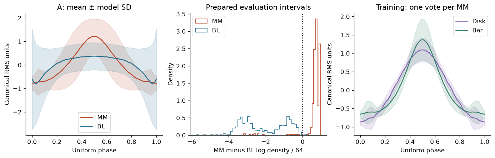
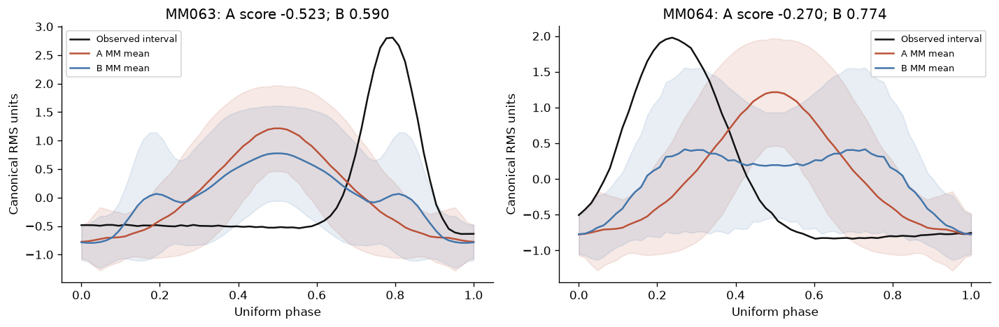
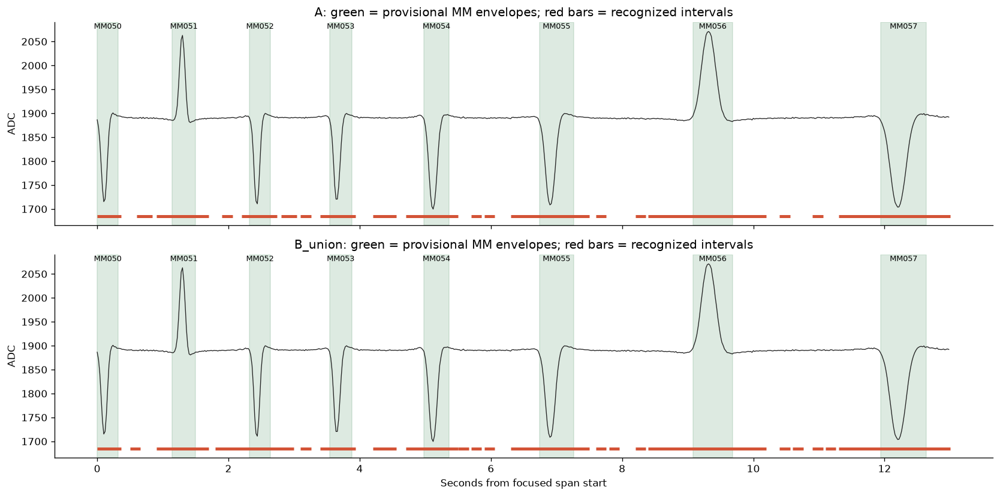
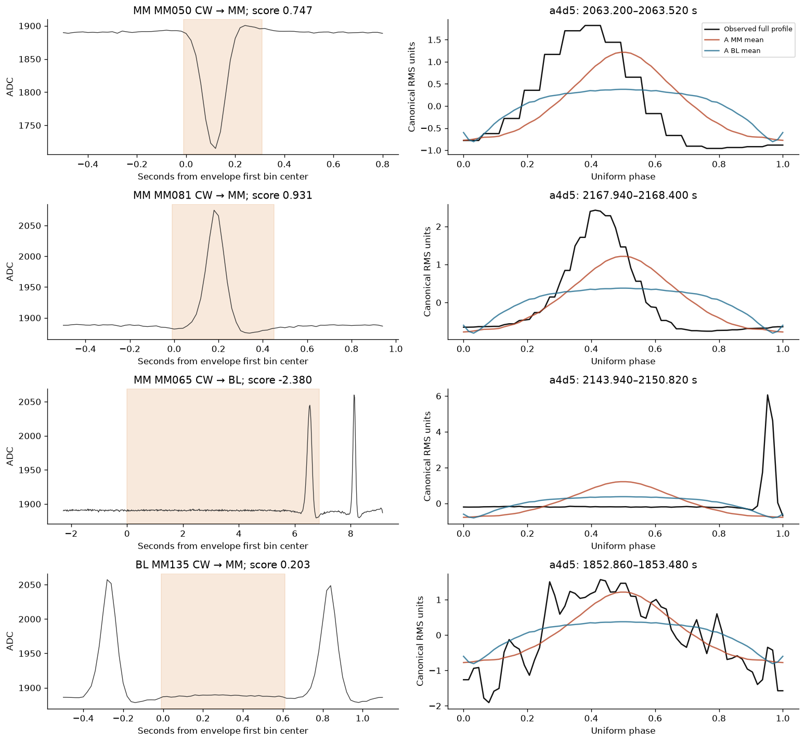
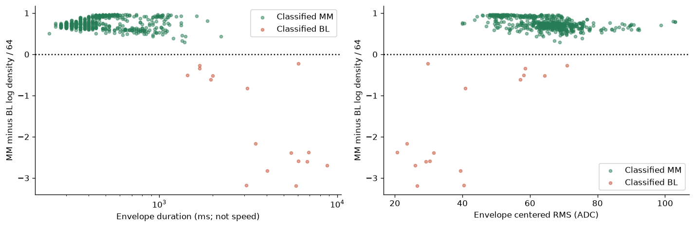

# NAVI_RVM independent statistical shape comparison

18 October 2026 · Research only · [assignment](sources/ASSIGNMENT.txt)

**The tested statistical profiles distinguish most prepared MM and BL intervals, but neither model recognizes them reliably in a continuous recording. Geographic references do not resolve that failure.** The general model classified 1,110 of 1,241 prepared evaluation intervals correctly, with 17 errors and 114 unresolved observations. On the identical focused continuous passages, A produced 239 detections entirely inside provisional baselines; B produced 307. These are failures of the tested method, not evidence that every possible statistical shape recognizer must fail. This is a bounded candidate-profile comparison; it does not validate joint `MM → BL → MM` recognition.

This investigation applies direct observation before proxy, keeps geographic expectation separate from waveform classification, and preserves adverse evidence. It proposes no operational architectural decision or departure from the project's decision principles. No firmware, locomotive configuration, Pi service, dashboard or hardware was changed.

## Evidence and independence

The starting project state is `codex/navi-rvm-manual-1-0-20261018`, commit `6aea978ae45e7164d176dfdda6d38ff41e8f272b`, verified against GitHub. The older primary checkout had unrelated changes and was left alone. This package lives on `research/navi-rvm-statistical-shape-comparison-20261018`.

Only source-data formats, provenance and documented failures informed the experiment. Neither Claude's probabilistic recognizer nor Codex's previous dynamic-programming alignment code was imported, copied or modified. The new research programs are [prepare.py](prepare.py), [evaluate.py](evaluate.py), [analyze.py](analyze.py) and [validate.py](validate.py). The first three are dataset construction, independent profile scoring, and descriptive analysis, respectively; none controls a locomotive.

The protocol and initial construction/evaluation code were committed as `b04e6dc` before running evaluation. No class, smoothing, normalization, model, scale, score or grouping parameter was retuned afterward. Subsequent corrections kept partition-edge annotations in continuous denominators, restricted boundary bins to evaluation exposure, and masked uninterpretable amplitude diagnostics on unresolved data. The model SHA-256 remained `1ae49f93c7569560e62a816a9793598fbf0e8311f51bd0fb3464ff0791d7d490`.

### Native recording inventory

| Boot ID | Native ADC observations | Original boot-clock coverage | Role |
|---|---:|---:|---|
| `4d8083de79a0e299` | 4,059,264 | 1.931705–814.302573 s | Supplementary evaluation |
| `15549e9385faa4d5` | 19,125,072 | 1.375316–3843.832414 s | Passage-separated construction/evaluation |

The original source is `/home/david/NGR/navi_sync/navi_sync_20261015_100403.nsr`, original bytes `[3331022388,4718850776)`, preceded by its 24-byte capture header. The locally preserved slice is `/Users/davidbrown/NGR/NGR-Files/navi-ewo-dart-experiment-1/field-records/20261015_IR_WAVE_1_ACCURACY/sources/native.nsr`; SHA-256 `123e51116ea964ce6a268cf441c8f0a440c56b1409e5b1b65e7f403da8eb6e8d`.

Both native-array files were rehashed against the previously verified payloads. The NSR slice was also rehashed. Previous validation recorded 1,370,029 valid frames, no CRC errors, and payload identity with those arrays; this investigation did not represent that prior decoding audit as a fresh decoding run. Exact source and portable-file hashes are in [input_manifest.json](sources/input_manifest.json).

Native ADC is averaged into nonoverlapping 20-ms boot-clock bins, weighted by original observation count. All 23,184,336 original samples contribute. Counts, native row ranges, serial ranges and validity masks are included. The 146 native acquisition discontinuities are retained; no gap is interpolated. [The frame index](data/native_frame_index.csv.gz) maps native rows back to exact NSR offsets. PWM and direction bytes are part of the archival record layout; neither PWM nor IR is exported as a recognition feature. Direction annotations partition the research examples, rather than qualify detections.

The [additional evidence inventory](sources/additional_recordings.csv) lists 150 nearby files from October 13, September research, waveform captures and field runs. These include derived tables as well as recording candidates. They were not audited as equivalent native evidence or pooled into these models. They are not claimed to be unseen independent holdouts. The entire October 15 recording is portable here as Hall-only means, including exposure outside annotated passages.

### Construction and evaluation partitions

| Boot / clock interval | Role |
|---|---|
| B before 1840.213501 s | Construction, including first complete CW reference passage |
| B 2745.450837–3167.014139 s | Construction, first complete CCW reference passage |
| B 1840.213501–2745.450837 s | Evaluation, including second complete CW lap and later CW observations |
| B after 3167.014139 s | Evaluation, later repeated CCW and final CW observations |
| All of boot A | Supplementary evaluation |

Reference/evaluation IDs are disjoint. Boundary-crossing examples remain unresolved. There are 529 usable MM construction profiles covering all 171 MM labels and 496 usable associated BL profiles. All 1,195 original selected-MM seeds are retained: 572 construction and 623 evaluation seeds. MM050–MM070 has repeated passages in both directions.

**Every recording used here had already been examined during NAVI development.** This includes the formerly reserved second CW lap, the first CCW lap, the earlier RVM replay, the October 17 baseline study and the manual-RVM diagnosis. No result here is a fresh blind holdout. The first complete CW/CCW passages are reference recordings with NAVI labels, not surveyed physical identity confirmations.

Model B has 21 conditional MM/BL models. Usable reference counts are only 1–4 intervals per class and location. **MM062 has only one usable MM reference; BL058, BL061 and BL062 each have only one usable BL reference.** Their additional candidate passages are present but unresolved under the frozen loss/annotation policy. Consequently, the assignment's desired repeated-reference construction is incompletely supported at those locations. Their variances rely heavily on the common statistical prior; time reversal does not create an independent repeat. All other B locations have repeated usable MM references. The JSON parameters expose every reference count.

## What the labels establish

Original NAVI opening labels only propose research neighborhoods. An annotation cell extends from the midpoint with the previous opening to the midpoint with the next opening in the same consecutive directional passage. Missing sequence, reversal, acquisition loss or passage edges cause unresolved examples, without inserting inferred magnets.

Within a complete cell, a line joins the median levels in its first and last tenth. A provisional ensemble envelope contains the central 99.8% of the squared residual energy, extended by one bin on each side. The complement between adjacent envelopes is a provisional baseline. This is a contour-based preparation convention, not a Hall-threshold detector, a duration qualification, or a speed estimate. The earlier ground study's acceptance status does not veto examples; the original seed list nevertheless comes from NAVI selection decisions and inherits that selection bias.

**These boundaries are not independent physical ground truth.** The convention favors intervals containing concentrated excursions and places their quiet complements in BL. Prepared-interval separation is therefore partly conditioned on how the examples were made. Long cells with substantial quiet tracing before a late excursion can produce an envelope that poorly represents a completed ensemble. Weak recovery tails can fall outside an energy envelope. No independent census establishes whether NAVI omitted or misidentified a physical magnet.

The dataset records every interval, exact native range and unresolved reason. The evaluation contains 623 MM and 618 BL rows; 45 MM and 69 BL are unresolved. They remain in correctness denominators. Full continuous scanning also includes unannotated exposure, whose detections retain unknown physical identity.

## Common statistical representation

Each entire candidate interval is integrated into 64 equal phase bins. Area integration makes every source bin contribute; no sample region can be skipped by alignment. Subtracting the mean removes offset; division by centered RMS removes positive gain. Principal polarity is canonicalized and retained separately. Reversal augmentation accommodates traversal direction. Only a uniform phase coordinate is used: no local stretching, shrinking or dynamic-programming path exists.

For class `c`, the working Gaussian profile has phase means `mu[c,j]` and diagonal variances `v[c,j]`. At every location, the same estimator uses 50% local variance plus 50% pooled construction-class variance, plus fixed ridge 0.05 in normalized units squared. A is the pooled general MM/BL model; B conditions the same estimator on the specified MM label and its following baseline. A includes all 171 labels. There are no individual waveform portraits or nearest-historical-waveform acceptance rules.

The score is:

`s(x) = (log p(x | MM) - log p(x | BL)) / 64`

Positive means MM, negative BL, and missing/constant/tied evidence is unresolved. Priors are equal. The 64 phase components are correlated observations, so these factorized working densities are classification scores, not calibrated physical probabilities or 64 independent trials. Ordering, polarity and within-interval lobe position are represented; coupled lobe relationships are not explicitly enforced by the diagonal statistical model. Reversal averaging also broadens asymmetric features.

The principal B interval comparison is **oracle-conditioned**: the existing annotation supplies the expected MM reference. This does not independently demonstrate geographic identification. A second B result uses an equal-weight mixture of all 21 geographic models within each class, without an expected-MM input. The continuous focused comparison uses that label-free mixture. B is never applied outside its defined coverage.

All model means, variances, fixed parameters and reference IDs are in [models.json](models/models.json). [The reference atlas](figures/all_171_reference_atlas.png) shows every usable construction MM contour.

## Prepared-interval comparison

Counts below use all evaluation rows in the indicated scope. Unresolved observations are neither correct nor quietly removed.

| Model / scope | MM correct | MM → BL | MM unresolved | BL correct | BL → MM | BL unresolved | Correct / all rows |
|---|---:|---:|---:|---:|---:|---:|---:|
| A, all geography | 562 | 16 | 45 | 548 | 1 | 69 | 1110/1241 = 89.44% |
| A, MM050–MM070 | 69 | 3 | 4 | 68 | 0 | 7 | 137/151 = 90.73% |
| B, oracle MM050–MM070 | 71 | 1 | 4 | 68 | 0 | 7 | 139/151 = 92.05% |
| B, label-free mixture, same region | 71 | 1 | 4 | 68 | 0 | 7 | 139/151 = 92.05% |
| A, outside MM050–MM070 | 493 | 13 | 41 | 480 | 1 | 62 | 973/1090 = 89.27% |

A's resolved-interval ROC AUC is 0.9898 overall and 0.9947 in the focused region. Oracle B has focused AUC 0.9943; mixture B has 0.9882. These AUCs describe score ranking on prepared, resolved examples; they do not include the unresolved examples or establish continuous performance.

A's median MM score is +0.729 and median BL score −2.306. The MM range is −3.188 to +0.968; BL is −5.761 to +0.203. The substantial score overlap includes 16 MM examples scored as BL and one BL scored as MM. Detailed quantiles are in [score_distributions.csv](results/score_distributions.csv).

B gains two correctly classified MM intervals, a 1.32-percentage-point gain across the 151 focused rows. A paired bootstrap with 21 MM clusters gives an exploratory 95% percentile interval of 0–3.42 percentage points. The small, correlated dataset, uncertain annotations and sparse B references preclude a strong superiority claim.

The gains are MM064 CW at 2130.080–2131.760 s (A −0.270, oracle B +0.774) and MM063 CW at 2546.100–2548.100 s (A −0.523, oracle B +0.590). Their conditional profile means/variances tolerate the observed phase distributions better than the pooled reference. That local information is absent from A's pooled distribution, but these two examples do not establish that individual geography is needed generally. Both models still reject the MM065 example below.

Geographic breadth is not confined to the focused segment: on the second complete CW lap, A gets 321/342 rows correct, with seven errors and 14 unresolved. On the earlier boot A, it gets 165/173 correct, with one error and seven unresolved. These are additional passage/region tests of known geography, not unseen-marker generalization: A's construction set intentionally includes every marker.

## Continuous recognition is the decisive failure

The scanner evaluates 13 uniform window scales from 0.16 to 20.44 seconds, every 100 ms. Those scales bound this offline computation; they are not geographic timing or duration acceptance gates. All usable evaluation MM envelopes fit inside that scale range. Windows touching loss remain unresolved. Positive-margin windows are selected by descending shape score, suppressing overlaps. No expected arrival, spacing, amplitude rule, minimum baseline duration or sequence-recovery rule follows.

This yields a simple completed-interval localization experiment. It cannot by itself guarantee one complete physical ensemble per chosen interval. That limitation is measured, rather than hidden with movement or recovery machinery.

The experiment classifies candidate MM/BL intervals; it does not fit a joint statistical distribution over the full overlapping `MM₁ → BL → MM₂` unit. Suppressing interval overlaps is not proof of that required physical grouping, and no geographic advancement mechanism is implemented. This limits the negative conclusion to the frozen profile method; it does not exhaust the operator's governing recognition concept.

| Continuous measure | A, all evaluation | A, focused | B mixture, identical focused spans |
|---|---:|---:|---:|
| Scanned exposure | 2396.36 s | 267.20 s | 267.20 s |
| Annotated MM, including unresolved | 623 | 76 | 76 |
| Matched MM envelopes | 571 | 71 | 70 |
| Usable MM envelopes missed | 7 | 1 | 2 |
| Unresolved MM annotations | 45 | 4 | 4 |
| Selected detections | 4794 | 477 | 592 |
| Detections wholly inside provisional BL | **1431** | **239** | **307** |
| Possible lobe splits | 33 | 1 | 1 |
| Other unassigned detections | 2759 | 166 | 214 |
| Provisional BL time left classified BL | **41.67%** | **38.62%** | **27.97%** |

Thus even the high envelope-match rate—571/623 = 91.65% with unresolved included—coexists with unacceptable baseline recognition. A detection can contain a real excursion while extending far into baseline. Unassigned detections include unannotated exposure and ambiguous boundaries; they are not all asserted to be physical false positives. Detections entirely inside provisional BL supply the clearer adverse evidence.

The plot shows the operator's prominent hills and valleys directly. Both scanners also find many convincing normalized shapes in the nearly level regions between them. Choosing among many short candidate windows changes the baseline shape distribution relative to the prepared, longer BL examples. Area resampling of a short noisy window can yield a smooth contour; amplitude normalization gives that contour unit scale. The frozen profile model does not reliably reject it. This is an observed limitation of the representation and candidate search, not a reason to introduce an amplitude gate.

One-to-one matching uses IoU >=0.3 as a reporting convention. Possible splits overlap already matched envelopes; physical lobe attribution remains uncertain. On matched events, the ADC sign agrees with the envelope sign in all 571 A matches, 71 focused A matches and 70 focused B matches. Across all 578 resolved prepared MM profiles, sign also agrees with the declared map's North/positive convention in 578/578 cases. This is consistency with the existing map, not independent magnetic metrology or proof of MM identity.

| Matched-event boundary measure | A, all evaluation | A, focused | B mixture, focused |
|---|---:|---:|---:|
| Median signed start error | −220 ms | −260 ms | −300 ms |
| Median absolute start error | 220 ms | 260 ms | 300 ms |
| 95th percentile absolute start error | 620 ms | 780 ms | 942 ms |
| Median signed end error | +140 ms | +180 ms | +220 ms |
| Median absolute end error | 140 ms | 180 ms | 220 ms |
| 95th percentile absolute end error | 460 ms | 510 ms | 624 ms |
| Median absolute midpoint error | 40 ms | 60 ms | 60 ms |
| 95th percentile absolute midpoint error | 140 ms | 185 ms | 161 ms |

These errors are conditional on matches against provisional boundaries; the misses and unresolved cases remain in the preceding table. There is no claim of physical field-boundary accuracy. The systematic early starts and late ends indicate overextended detections.

## Successful and unsuccessful comparisons

The plot uses deterministically selected examples, with exact serials in [plot_cases.csv](results/plot_cases.csv):

- MM050 CW, boot B, 2063.200–2063.520 s: A recognizes a negative principal excursion; its canonical score is +0.747.
- MM081 CW, boot B, 2167.940–2168.400 s: A recognizes the principal hill and recovery contour; score +0.931. Weak recovery outside the provisional envelope illustrates why energetic containment is not a physical full-field guarantee.
- MM065 CW, boot B, 2143.940–2150.820 s: A says BL, score −2.380. The provisional envelope contains a long quiet portion before a late excursion. This is an annotation/representation failure, not proof that a physical MM became a baseline.
- BL following MM135 CW, boot B, 1852.860–1853.480 s: A says MM, score +0.203. The original tracing is nearly level; centered RMS is only 0.962 ADC. Normalization exposes a hill-like fluctuation. No amplitude gate is added to conceal the overlap.

The representation preserves every bin **inside the supplied interval**, including opposite-sign lobes and shoulders. It cannot locally warp them away or align a principal excursion onto a small shoulder. However, finite phase resolution can average away fine detail; a proposal can still contain only a partial ensemble, and the provisional reference envelope can omit weak tails. **Complete physical ensemble preservation is not established.** The observed grouping/boundary failures are material failures against that requirement.

## Amplitude, width and shape families

Observed A true-positive MM envelopes span 0.24–2.22 s and 39.94–103.02 ADC centered RMS. The 16 prepared false-negative MM envelopes span 1.44–8.76 s and 20.74–70.96 ADC RMS. The correctly classified BL range is 0.52–27.76 s with centered RMS 0.26–3.10 ADC. These are descriptive intervals after annotation; they are not class qualifications.

With training-MM duration quartiles fixed at 340, 440 and 580 ms, A recognizes 130/130, 170/170 and 118/118 resolved MM examples in the first three strata; in the broadest stratum it recognizes 144/160. A's lowest-amplitude stratum, below 57.81 ADC RMS, has 120/132 correct MM classifications. The unresolved examples form their own stratum: 45 for A and four for focused B. Broader/shorter real profiles also change noise averaging, asymmetry and annotation context, so mathematical scale invariance does not imply equal empirical recognition across those strata.

Arithmetic checks confirm gain/offset invariance to roughly 2×10⁻¹³ normalized units and uniform-width resampling invariance to 9×10⁻¹⁵. Every perturbed source bin affects the profile. Those are software checks. There is no independently calibrated speed experiment here; duration cannot establish speed, especially around long quiet or stopped intervals. These recordings therefore support observed temporal-width comparisons, not a claim of validation across all operating speeds or sensor amplitudes.

The [August 28 operator walking survey](sources/magnet_type_survey_20260828.md) identifies 101 disks and 70 bars, described as on top of versus level with the sleeper. It does not label a separate verified "ballast" class. No new physical type survey was performed for this investigation.

Using one mean construction profile per MM, disk/bar average shapes differ: mean phase squared difference 0.0326. An unrestricted marker-label permutation gives a tail fraction approximately 0.0002, but does not preserve geographic blocks; it is not a spatially corrected significance test. Geography, installation and observation conditions remain confounded, and marker labels are still NAVI-derived. The general model nevertheless has resolved-interval AUC 0.9949 in disk geography and 0.9804 in bar geography. Both groups are often recognized in prepared intervals; both coexist with the baseline-scanning failure. **There is evidence of distinguishable average shape families, but no demonstration that separate families are necessary or sufficient for reliable recognition.** No additional family recognizer was built after the failure.

Boundary sensitivity reinforces the preparation limit. Keeping the model fixed while changing energy tails from 0.1% to 0.5% reduces A's prepared MM errors from 16 to five, with no BL false positive; at 1% tails, four MM errors remain. Mixture B instead rises from one MM error to 15 at 1% tails. These are deliberately adverse diagnostics, not settings selected to improve the headline result. The primary convention remains frozen at 0.1% tails.

## Conclusion and unresolved questions

The available evidence does not establish reliable continuous MM/BL recognition by either tested statistical model. It does establish that a single general profile distribution can classify many prepared magnetic and baseline contours without historical individual portraits, amplitude/width gates or movement qualification. Geographic references add little in that task and worsen baseline detections in the identical continuous focused experiment. There is no demonstrated recognition advantage sufficient to justify geographic portraits on this evidence.

The operator's visual observation remains compatible with the recordings: the prominent magnetic hills and valleys are readily visible. This experiment does not translate that observation into a reliable statistical recognizer. It fails especially when selecting and grouping intervals from the continuous tracing; uncertain reference boundaries and the simple diagonal profile model limit interpretation further.

The remaining questions are physical ensemble/lobe boundaries, unselected physical encounters, repeated usable references at the sparse B locations, recognition under independently documented speed/amplitude changes, and genuinely unexamined recordings. Those are evidence gaps, not permission to build a tracker or a recovery mechanism. Neither model is recommended for operational adoption. No substitute recognition subsystem was introduced.

All model construction, predictions, unresolved rows, plots and provenance are included. [Validation passed](results/validation.json) for portable evidence hashes, reference/evaluation separation, geographic scope, complete denominators, all-bin participation and normalization arithmetic. A [clean portable reproduction](results/portable_reproduction.json) rebuilds the models and results without native archives or prior model outputs. These checks establish reproducibility and accounting, not physical ground truth.
