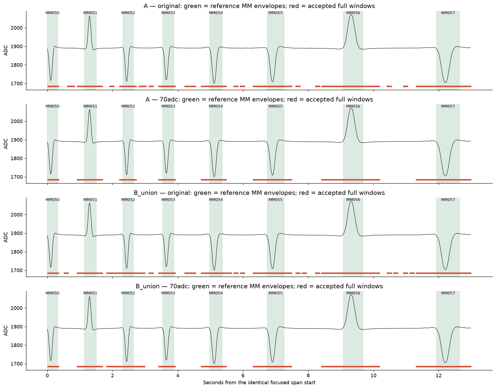
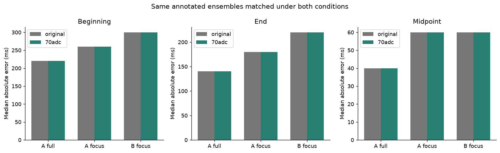
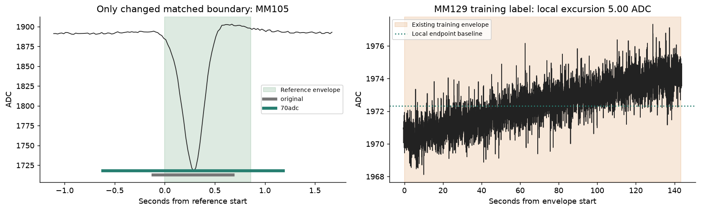

# NAVI_RVM: statistical shape recognition with a 70-ADC excursion requirement

18 October 2026 · Repeat of `804f1a2` · [Operator authorization](ASSIGNMENT.md)

**The experiment supports combining amplitude and statistical shape recognition on these recordings.** Requiring a principal excursion of at least 70 ADC counts eliminates every detection wholly inside the annotated baselines, without losing any previously matched magnetic ensemble. The original split-error proxy also falls to zero. Models, reference data, evaluation exposure and shape scores are unchanged.

This is a substantial improvement over the amplitude-normalized experiment. It does not correct the existing overextended ensemble boundaries, resolve uncertain geography, or eliminate the pre-existing misses. No operational change is proposed or made.

## Exactly what changed

The source is commit `804f1a2d9306d7c2d19c9ee1be69be4a5ca2fc30`. The complete [original research package](../statistical-shape-20261018/README.md), including all original results, remains byte-for-byte unchanged. The revised experiment is in this separate directory and branch `research/navi-rvm-shape-70adc-20261018`.

The frozen [repeat protocol](PROTOCOL.md) and initial repeat code were committed as `2014389` before evaluation. The 70-count value came from the operator; it was not tuned against these results. The latest instruction authorizes this amplitude condition for this experiment, superseding the original assignment's amplitude-gate prohibition only to that extent.

Both saved models are loaded directly, without fitting or changing parameters. Their SHA-256 remains `1ae49f93c7569560e62a816a9793598fbf0e8311f51bd0fb3464ff0791d7d490`. The original `features`, `scores` and `match_events` functions are used directly. Candidate scales, stride, polarity handling, loss masks, score ranking, overlap suppression, evaluation annotations and matching criteria are unchanged. There are no movement inputs, predicted arrivals, new thresholds, recovery rules or geographic tracking.

The local baseline is the original candidate endpoint-level estimate: the mean of the first six and last six unnormalized 64-phase bins. Principal excursion is the greatest positive or negative departure of the candidate's **original 20-ms ADC observations** from that local baseline. Measuring the peak before 64-bin averaging avoids attenuating a narrow principal excursion for this requirement.

The original acceptance condition is a finite positive shape score. The revised condition is the same positive score **and excursion >=70 ADC counts**, inclusively. That condition is applied before the original overlap suppression, so a rejected small fluctuation cannot block another candidate.

No threshold crossing determines a boundary. No waveform is truncated, and no lobe or shoulder is removed from the shape input. The complete original candidate window, including all available transitions, is supplied unchanged to the statistical scorer. The original experiment's uncertainty about whether a finite window contains an entire physical ensemble remains; it is not repaired or concealed here.

## Paired continuous recognition results

Each entry below is **original → 70-count condition**. "Recognized" means the unchanged one-to-one match against a usable provisional MM envelope, with IoU >=0.3. These are the original research annotations, not newly verified physical geography.

| Measure | A, full evaluation | A, MM050–MM070 | B, identical MM050–MM070 spans |
|---|---:|---:|---:|
| Scanned exposure | 2396.36 → 2396.36 s | 267.20 → 267.20 s | 267.20 → 267.20 s |
| MM annotations, including unresolved | 623 → 623 | 76 → 76 | 76 → 76 |
| Correctly recognized MM envelopes | **571 → 571** | **71 → 71** | **70 → 70** |
| Usable MM envelopes missed | **7 → 7** | **1 → 1** | **2 → 2** |
| MM annotations unresolved | 45 → 45 | 4 → 4 | 4 → 4 |
| Detections wholly inside provisional BL | **1431 → 0** | **239 → 0** | **307 → 0** |
| Possible incorrect splits | **33 → 0** | **1 → 0** | **1 → 0** |
| Other unassigned detections | 2759 → 47 | 166 → 4 | 214 → 5 |
| Total accepted detections | 4794 → 618 | 477 → 75 | 592 → 75 |

B is the original label-free mixture of the 21 geographic models, used only within its defined coverage. It is not an oracle-conditioned geographic scan and is not applied to other regions.

There is **no hidden exchange of lost and gained matches**. The annotation-by-annotation comparison finds zero newly lost and zero newly gained matches for each of the three comparisons. The same 571, 71 and 70 annotations remain matched. The seven/one/two existing missed-annotation identities also remain unchanged. [All paired annotations](results/annotation_comparison.csv), including unresolved cases, are preserved; the [lost](results/newly_lost_matches.csv) and [gained](results/newly_gained_matches.csv) tables are empty except for their column headers.

The split measure retains the original definition: an unmatched detection overlapping an already matched MM envelope. Its reduction to zero means this annotation-based grouping error disappears in the repeat. It is not independent physical proof of every lobe's attribution.

Unassigned detections are kept separate. They can include unannotated activity, partial or uncertain envelopes and acquisition-censored passages; they are not all asserted to be false physical magnets. Unresolved annotations remain in the denominators. Recognition with unresolved included therefore remains 571/623, 71/76 and 70/76.

The red intervals show that the revised detector keeps the large hills and valleys while removing the many separate detections on the nearly level tracing. The statistical shapes and their scores have not been changed to produce this result.

## Boundary and midpoint accuracy

All matches are common between the conditions, so this comparison does not benefit from dropping difficult matched cases. The following median and 95th-percentile absolute errors are **unchanged** under the new condition. Each cell is median / 95th percentile, in milliseconds.

| Scope | Matched MM | Beginning error | End error | Midpoint error |
|---|---:|---:|---:|---:|
| A, full evaluation | 571 | 220 / 620 | 140 / 460 | 40 / 140 |
| A, focused | 71 | 260 / 780 | 180 / 510 | 60 / 185 |
| B, focused | 70 | 300 / 942 | 220 / 624 | 60 / 161 |

The signed median start/end/midpoint errors also remain −220/+140/−40 ms for full A, −260/+180/−50 ms for focused A, and −300/+220/−60 ms for focused B. Early beginnings and late endings remain the dominant boundary bias. The original misses and unresolved cases are reported above, outside these conditional error statistics.

Exactly one full-A matched interval changes its boundaries: MM105 CW, boot B, annotation `MM_15549e9385faa4d5_11019605`. It changes from `[2204.020,2204.820)` s to `[2203.520,2205.320)` s. The reference is `[2204.140,2205.000)` s. Its beginning error worsens from −120 to −620 ms, its end error changes from −180 to +320 ms, and its midpoint error remains −150 ms. Removing a competing low-excursion window allows the unchanged greedy selection to choose a higher-shape-score, broader candidate. No boundary was set by an amplitude crossing.

Consequently, full-A mean absolute beginning error increases slightly from 273.27 to 274.15 ms, and mean absolute end error from 172.78 to 173.03 ms; mean absolute midpoint error remains 64.82 ms. Every focused matched interval keeps exactly the same beginning, end and midpoint as before. Full [boundary statistics](results/boundaries.csv) include both all matches and paired common annotations.

Zero detections wholly inside BL does **not** mean zero baseline time labeled magnetic. Windows containing a real magnet still extend into adjacent baseline. Correctly left-as-BL time rises from 41.67% to 73.39% for full A, from 38.62% to 71.99% for focused A, and from 27.97% to 68.40% for focused B. Thus 26.61%, 28.01% and 31.60% of the respective provisional baseline time remains covered by accepted windows. The 70-count condition solves the small separate baseline detections; it does not solve window extent.

## What the ADC evidence shows

Using this same local-baseline definition on intact usable reference/evaluation envelopes, without changing their membership:

| Existing envelopes | Count | Below 70 ADC | Observed principal-excursion range |
|---|---:|---:|---:|
| Construction MM | 529 | 1 | 5.00–283.67 ADC |
| Construction BL | 496 | 496 | 1.03–10.68 ADC |
| Evaluation MM | 578 | **0** | **88.72–284.65 ADC** |
| Evaluation BL | 549 | **549** | **2.33–10.88 ADC** |

The evaluation magnetic envelopes are well above the requested 70-count value, while the baseline envelopes are far below it. Their medians are 178.42 and 5.02 ADC. This is the physical distinction the amplitude-normalized experiment deliberately discarded. The controlled repeat shows that restoring that distinction can remove the quiet-baseline false detections while preserving the existing shape-recognized ensembles.

The exceptional construction envelope is the pre-existing MM129 label `MM_15549e9385faa4d5_1965405`, boot B. It spans a long, slowly changing elevated level and has only about five counts of excursion relative to its own local endpoint baseline. This is not verified evidence of a genuine five-count pass-over ensemble: the original labels and envelope construction were provisional. It exposes a reference/annotation limitation. **That example is still present in the unchanged reference data and saved models.** No reference was removed, relabeled or refitted to favor this result. [All diagnostic envelope measurements](results/envelope_excursions.csv) are available for inspection.

## Reproducibility and interpretation

The original control reproduces **all 5,873 original event rows and all 11 original summary rows byte for byte**, including scores, ordering, matching and boundary errors. Those reconstructed CSVs are included. All 51 original package artifacts, including its manifest, retain their hashes. Full-profile feature difference is exactly zero across the paired candidate calculation. Models were never refitted.

The [candidate audit](results/candidate_audit.csv.gz) records all 54,526 positive-shape proposals across the original full/focused scans, with baseline, extrema, excursion, unchanged score and selection status under both conditions. Both signs, equality at 70, rejection below 70, peak measurement before phase averaging, eligibility before suppression and whole-window preservation are checked in [checks.json](results/checks.json). [Clean-copy reproduction](results/portable_reproduction.json) rebuilds results and plots without a native archive, new training or prior revised outputs.

On these previously examined recordings, the proposed combination succeeds at the specific test: it eliminates baseline-contained false detections and the split proxy without introducing a missed ensemble. The original conclusion that the amplitude-normalized profiles were inadequate remains valid for that original condition; it should not be generalized to the now-tested combination of physical amplitude and statistical shape recognition.

Model B offers no recognition advantage in the focused comparison after the same 70-count requirement: A retains 71 matches and one miss, while B retains 70 matches and two misses, with zero baseline-contained detections for both. The general model remains the simpler reference option supported by this comparison. This is a research finding, not an operational architecture or deployment decision.

These reused development recordings are not a fresh blind holdout. Existing geographic and field-boundary uncertainties, sparse geographic references, the 45/four unresolved annotations, pre-existing misses, unassigned detections and overextended windows remain limitations. The repeat does not validate a complete joint `MM → BL → MM` navigation recognizer or authorize firmware changes. No additional threshold, movement estimate, recovery mechanism or recognition architecture change was introduced.
