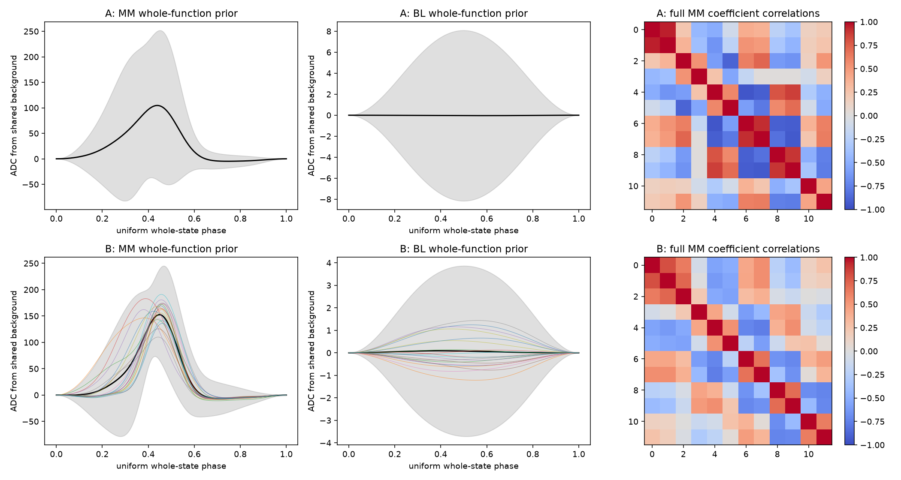
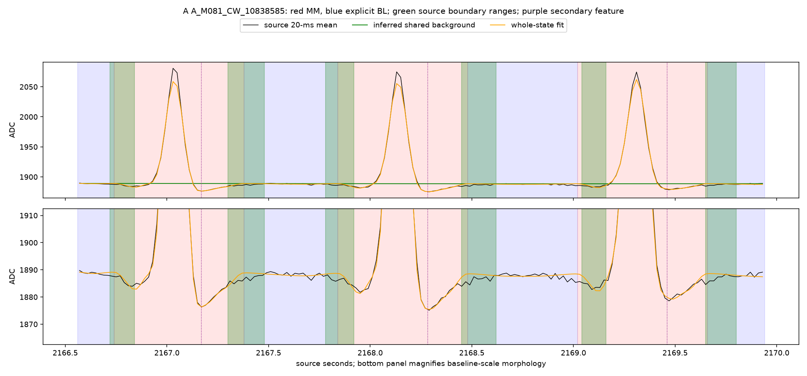
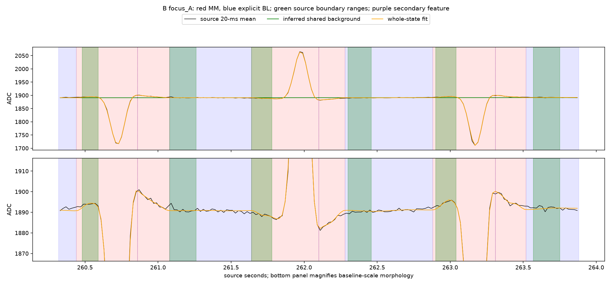

# NAVI_RVM: corrected whole-function recognition experiment

**The replacement model was constructed and replayed, but this experiment does not establish the requested complete MM–BL–MM recognition.** Under the source-only review criteria frozen before evaluation, A recognizes 1 of 28 eligible complete fields and B recognizes 2. Neither validates a complete overlapping unit. Both keep the reviewed principal and secondary-lobe landmarks together in 28/28 cases; the principal unresolved issue is complete transition/boundary ownership, rather than absence of the principal signal.

These are conditional results against one analyst's provisional source-morphology review, not independently surveyed physical field boundaries. The stringent recovery-landmark criterion is sensitive to the 20-ms source grid and ambiguity between weak magnetic tails and gently curved baseline. **The other 27/26 cases must not be reported as 27/26 physically absent magnets.** There are zero principal misses in the reviewed cohort; most cases remain incomplete or uncertain under the complete-field definition. No evaluation-dependent change was made to turn those cases into successes.

The full research package is on branch `research/navi-rvm-whole-ensemble-20261018`, based on `8c40d6d`. Source morphology was committed before evaluation at `be4c6a3`; learned models and replay inputs were frozen at `1c2d14d`. No firmware, operational service, dashboard, motor control or navigation recovery code changed.

## Recognition mechanism actually implemented

[`functional.py`](functional.py) replaces the earlier classifier. It fits an entire eligible continuous ADC passage with a joint alternating sequence of explicit curved BL states and whole-function MM states. Each MM is one supported random function with twelve coefficients and a **full covariance**, raw amplitude, whole-function polarity/reversal alternatives, and zero value/slope at its transition to a shared smooth background. BL has its own three-coefficient curved-function distribution. Student-t observation noise continuously discounts residuals without deleting spikes or applying an admission gate.

The complete alternating path and its shared boundaries are selected jointly by dynamic programming, conditional on the common background and noise precisions. There is no list of detected excursions, positive-window admission rule, greedy overlap suppression, 70-count cutoff, independent lobe rejection or subsequent duplicate repair. Noise/background/path fitting uses three fixed approximate coordinate passes. All available durations on an 80-ms numerical boundary lattice are considered, then boundaries are jointly refined at 20-ms resolution. The `log(N)` MM complexity prior and numerical approximations were frozen before evaluation.

[`ARCHITECTURE.md`](ARCHITECTURE.md) gives the exact likelihood, functions, priors and limitations. In particular, the likelihood factorizes into whole-state functions conditional on a shared background: it does **not** learn a higher-order joint covariance across two neighboring magnets and their baseline. Serialized MM–BL–MM objects alone are not proof of physical unit recognition. A complete-function representation can still be fitted to an incomplete physical support; its state name does not settle lobe ownership.

## Dataset and stationary exclusions

The same two source recordings and clock partitions as the controls are retained. All 23,184,336 native Hall observations remain inventoried; recognition uses their unchanged 20-ms mean tables. Movement preparation is separate from recognition. The recognizer receives ADC arrays and frozen statistical parameters only.

| Partition | Eligible time | Excluded clock time | Eligible passages |
|---|---:|---:|---:|
| Training | 1,034.22 s | 1,227.56 s | 89 |
| Evaluation, identical A/B | 1,195.70 s | 1,200.68 s | 89 |

There are 180 contiguous excluded intervals, including recording/partition gaps. **No interval has independently confirmed physical stationarity.** Stop-supported, stale-count, held, contradictory, unbracketed and otherwise uncertain evidence is excluded. Nonzero PWM is not movement proof, and zero PWM is not stop proof. Actual clean count advances support 1,982.44 s; a further 247.48 s consists of explicitly labeled interpulse continuity or source bins mixing direct and interpulse support. That inference cannot rule out a subpulse pause. Perfect removal of every brief stop remains unproven.

No waveform is joined across an exclusion. Fields touching an eligible passage edge are censored. All exclusions, evidence, source hashes and their resolution limits are in the [stationary/eligibility report](STATIONARY_REPORT.md), [source inventory](results/source_inventory.csv), [contiguous exclusions](results/excluded_contiguous_intervals.csv) and [detailed evidence ranges](results/eligibility_intervals.csv). These are reused development recordings, not a new blind field trial.

## References constructed

A's final parameter-construction update uses 795 inferred closed MM states and 777 BL states. The 551 MM states with one provisional opening represent **all 171 locations**; MM016 has only one such construction observation. Another 244 MM states have no opening hypothesis. They remain in the unsupervised A fit, and are **not independently certified magnetic fields**. The [171-location audit](results/all171_reference_audit.csv) identifies the actual fitting cohort; it separately records the final provenance replay, which contains 670 closed MM states without another parameter update.

B uses 65 single-label inferred MM states from MM050–MM070 and 73 unique adjacent BL states from that final training replay. Every focused location has two to four MM observations. [Every count and reference ID is published](results/geographic_references.csv). Its 21 geographic means are shrunk toward the focused pool; each class shares a full covariance pooled **within that focused cohort**. These are not 21 independently estimated covariance matrices. Noise, shared-background prior, inference code, eligibility, evaluation observations and scoring are identical to A.

There is a comparison limitation: A's unsupervised pool includes unlabeled inferred states, whereas B's geographic reference necessarily uses states with an unambiguous opening label. Thus any advantage can reflect reference-cohort cleanliness as well as geographic conditioning. Neither cohort has an independent complete-field construction audit. Label coverage is established; complete physical reference coverage is not. This frozen attempt does not cleanly isolate a causal advantage from geographic portraits.

## Evaluation evidence and definitions

Thirty source structures were marked **before predictions**: six three-field panels around historically reviewed undershoots, and four three-field panels covering repeated MM050–MM052 hypotheses in both recording boots and directions. This is a targeted convenience cohort, not a random sample of all 171 magnets. It contains 28 entirely eligible fields and two censored fields; the focused subset contains 11 eligible fields and one censored field. Twenty baseline cores and 18 eligible adjacent two-field units are available overall; eight cores and seven units are focused.

The [frozen source CSV](sources/morphology_adjudication.csv), [criteria](sources/MORPHOLOGY_REVIEW.md), and source-only plots preserve the principal/leading/secondary/recovery landmarks and start/end uncertainty ranges. A complete success requires all four landmarks to belong to one closed MM object, both boundaries inside those ranges, no neighboring principal, and no extra MM piece in the confident ownership interval. A complete unit requires two such fields and one explicit intervening BL covering its source core. Successive units reuse the same central MM object ID.

The original frozen `lobe_grouped` measure includes the selected recovery landmark. Additional descriptive columns separate principal–secondary ownership, leading ownership and recovery ownership; **they do not change the frozen pass test**. A recovery exactly at a half-open state endpoint is assigned to BL by this implementation. Small transition disagreements can therefore fail the strict test even with a visually faithful whole-curve fit and boundaries within the review ranges. These scores do not settle every physical boundary dispute.

## Complete fields, lobes, baselines and units

| Measurement, same reviewed source cohort | A | B |
|---|---:|---:|
| Eligible fields / movement-censored fields retained | 28 / 2 | 28 / 2 |
| Complete fields under frozen criterion | **1/28** | **2/28** |
| Principal landmarks classified BL (principal misses) | **0/28** | **0/28** |
| Remaining fields not established complete | 27/28 | 26/28 |
| Principal and secondary landmark share one closed MM | **28/28** | **28/28** |
| Leading landmark shares principal's MM | 27/28 | 26/28 |
| Principal, secondary and selected recovery share one MM | 3/28 | 4/28 |
| Recovery landmark classified BL | 23/28 | 24/28 |
| Fields with multiple MM pieces in ownership core | **3/28** | **0/28** |
| MM states wholly contained in reviewed baseline cores | **0** | **0** |
| Baseline cores intruded into by MM states | **10/20** | **8/20** |
| Explicit single BL covers entire reviewed core | 10/20 | 12/20 |
| Principal polarity agrees with source morphology | 28/28 | 28/28 |
| Complete eligible MM–BL–MM units | **0/18** | **0/18** |

A's qualifying field is the MM080 hypothesis before the 2168-s MM081 undershoot. B also qualifies the MM001 hypothesis around 3470.2 s. B's second qualifying field is **outside its construction geography**. Neither has two adjacent qualifying fields forming a reviewed complete unit.

The actual maximum source excursion within each reviewed field also lies in the same inferred object as its frozen principal landmark in 28/28 eligible cases for both models ([A check](results/source_peak_ownership_A.csv), [B check](results/source_peak_ownership_B.csv)). Hand-marked principal times are landmarks on the principal excursion, not precisely measured extrema.

A's three split cases are the reviewed MM087 hypothesis near 2577.6 s and the MM091/MM089 hypotheses around 3247.7/3250.6 s. The primary and secondary feature still share an MM; the extra pieces concern other parts of the source ownership interval. They were reported, not discarded or merged. Counting unique MM IDs prevents double counting the same latent object across adjacent units, but cannot prevent multiple latent objects representing one physical field.

Zero fully contained false MMs applies only to these twenty cores. It is **not** a whole-recording zero-false-magnet claim. MM intrusion can consume baseline even without a separate baseline-contained detection. A railway-wide genuine missed/false/duplicate census is unavailable because unselected encounters, physical geography and complete boundaries are not independently labeled.

## Focused A versus B comparison

| Same eligible MM050–MM052 source review | A | B |
|---|---:|---:|
| Complete fields | 0/11 | 0/11 |
| Principal misses | 0/11 | 0/11 |
| Principal and secondary share one MM | 11/11 | 11/11 |
| Principal, secondary and recovery share one MM | 0/11 | 0/11 |
| Split fields | 0/11 | 0/11 |
| Contained false MMs in baseline cores | 0 | 0 |
| Baseline cores intruded into | 5/8 | 4/8 |
| Explicit BL covers core | 3/8 | 4/8 |
| Complete units | 0/7 | 0/7 |

B gives modest descriptive boundary/baseline differences, but **no demonstrated advantage in complete focused fields or units**. The reviewed focused cohort covers three of the 21 construction locations, not all MM050–MM070. Selection bias, small targeted coverage and the construction-cohort confound prevent a general statistical or geographic superiority claim.

## Boundary and midpoint accuracy

Errors below are absolute distance **outside the source uncertainty range**, zero anywhere inside it. Midpoint means the temporal average of start and end, not a surveyed magnet center or inferred travel position. All 28 eligible principal-assigned MM objects are included, not just the 1/2 complete successes.

| MM scope | A median start / end / midpoint | B median start / end / midpoint |
|---|---:|---:|
| All 28 eligible reviewed fields | 20 / 20 / 12.5 ms | 10 / 20 / 7.5 ms |
| Same 11 focused fields | 40 / 30 / 35 ms | 30 / 20 / 30 ms |

Both MM boundaries lie inside the source ranges in 6/28 A fields and 7/28 B fields. Small median interval errors coexist with few strict successes because completeness additionally requires feature/recovery ownership and one physical grouping. The medians are not evidence that every field is complete, nor independent physical metrology.

For the 10 A and 12 B baselines that entirely cover their source core, median start/end errors outside the corresponding return/departure ranges are 10/0 ms for both. The other 10/8 cores fail explicit full-core coverage and are not hidden in those conditional errors. Focused conditional baseline errors are 30/0 ms for A (n=3), 20/0 ms for B (n=4). Per-event signed errors to range centers and interval errors are in the [field](results/morphology_fields_A.csv) and [baseline](results/baseline_cores_A.csv) tables, with corresponding B tables beside them.

## Whole-recording accounting, not physical success counts

| Continuous eligible replay | A | B |
|---|---:|---:|
| MM states, including edge-censored | 771 | 727 |
| Closed MM objects | 735 | 692 |
| Edge-censored MM objects | 36 | 35 |
| Explicit BL states | 823 | 780 |
| Closed serialized MM–BL–MM hypotheses | 681 | 639 |
| Opening hypotheses in a closed MM | 603 | 604 |
| Opening hypotheses in an edge-censored MM | 15 | 14 |
| Opening hypotheses excluded by eligibility | 5 | 5 |

All 623 original evaluation openings remain in [annotation accounting](results/annotation_accounting.csv). All 76 focused openings associate with closed MM objects for both models. Their inferred signs agree with declared map polarity in all 618 eligible opening associations. Those are **point associations and polarity consistency**, not 603/604 recognized complete fields, independent identity verification, or validation of 681/639 physical units. Unreviewed observations remain unresolved for physical completeness.

## Comparison with preserved experiments

These are the unchanged archived continuous-scan results:

| Old annotation/window metric | Original A full | 70-ADC A full | Original A focused | 70-ADC A focused | Original B focused | 70-ADC B focused |
|---|---:|---:|---:|---:|---:|---:|
| Provisional envelopes matched | 571 | 571 | 71 | 71 | 70 | 70 |
| Usable envelope misses | 7 | 7 | 1 | 1 | 2 | 2 |
| Unresolved opening/envelope annotations | 45 | 45 | 4 | 4 | 4 | 4 |
| Detections wholly inside provisional BL | 1,431 | 0 | 239 | 0 | 307 | 0 |
| Overlap split proxy | 33 | 0 | 1 | 0 | 1 | 0 |

The archived matched-window median absolute start/end/midpoint errors are unchanged by 70 ADC: 220/140/40 ms for full A, 260/180/60 ms for focused A, and 300/220/60 ms for focused B. They are errors to energy-envelope annotations conditional on IoU matches. The new interval errors use different physical-review hypotheses and a different denominator; a smaller new median is **not a directly comparable improvement**.

The old 571 matches demonstrated window/envelope correspondence. The new 603/604 point associations are yet another association definition and must not be compared as recognition gains. Stationary/uncertain exclusions also change exposure. The old zero baseline-contained detections after 70 ADC and the new zero contained MMs in twenty reviewed cores do not establish the same whole-recording result. The new experiment removes the independent amplitude gate and tests a different whole-state model; it does not overturn the controlled amplitude finding or certify the old architecture.

All **80 tracked files across both prior packages are byte-identical to `8c40d6d`**. Neither historical report was rewritten to conform to this interpretation.

## Amplitude, breadth and spikes

Eligible reviewed source fields have observed principal excursions of **161.68–252.72 ADC**, measured from the source extremum within the reviewed outer field and a local source-background estimate. Reviewed temporal breadth centers span **0.545–0.770 s**, with outer uncertainty bounds spanning 0.410–0.940 s. Both models contain the principal and secondary landmarks over that cohort, but strict complete-field success is not demonstrated throughout it. This narrow targeted cohort cannot establish reliable recognition of weak fields, the full railway's amplitude variation, or all traversal conditions.

All inferred closed-state amplitudes span 0.74–275.09 ADC for A and 0.45–275.16 ADC for B; their temporal supports span 0.02–3.30 s and 0.02–3.74 s. These ranges include unvalidated/spurious or incomplete hypotheses and must not be described as recognized genuine magnetic strengths or speeds. **No speed estimate is computed.** Source breadth is a time measurement only.

Student-t noise supplies a statistical isolated-residual explanation, not a separately thresholded spike rejector. Its architecture is verified; physical spike-discrimination accuracy has not been independently annotated here. Coherent genuine signal can also be downweighted by an inadequate fit. [Source variation and outcomes](figures/reviewed_variation.png) and the full fitted background/field/precision arrays are preserved.

## Validation and remaining limits

Four deterministic arithmetic tests passed: exact Gaussian marginal comparison, exhaustive small-case path comparison, dense shared-background prior comparison, and endpoint/slope continuity. Both A/B state partitions cover every eligible ADC bin exactly once, never cross an excluded interval, and reuse identical central MM IDs across overlapping units. Portable eligibility reconstruction reproduces seven output files byte-for-byte. Four actual-recording A/B replays reproduce states, coefficient means/covariances, background, field and noise-precision arrays exactly. Full training was run once; this is not represented as a second independent training reproduction. See [integrity](results/integrity.json), [replay checks](results/replay_validation.json), [test output](results/implementation_tests.txt), and [reproduction instructions](REPRODUCE.md).

The main unresolved evidence is physical outer-field ownership where weak recovery meets curved baseline. Source ranges are one analyst's interpretation, and the strict half-open landmark test is sensitive at transitions. Neither unreviewed geography nor the self-fitted training reference supports independent physical completeness claims. Approximate coordinate inference, final background update timing, 64-bin quadrature, fixed coarse topology during refinement, shared geographic covariance, reference-cohort differences and movement resolution are additional limitations, all disclosed in the architecture/data reports.

The model demonstrates joint whole-curve fitting and principal–secondary grouping on the reviewed passages. It **does not meet the frozen complete overlapping-unit test**, and this evidence cannot establish reliable physical complete-ensemble recognition or a meaningful geographic-reference advantage. Work stops with this frozen negative/inconclusive experiment. No substitute model, new threshold, lobe repair, missed-magnet recovery or operational change was introduced after examining these results.
